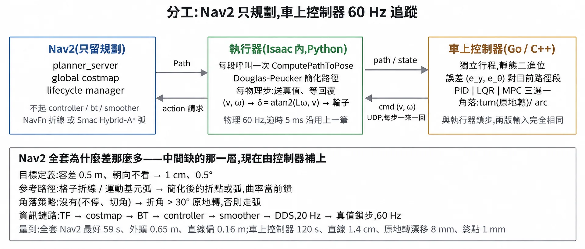

# Nav2 只規劃、車上追蹤:同一台叉車走同一個正方形,為什麼全套 Nav2 與直接寫控制器差那麼多

一台三輪叉車(前兩固定輪、後單輪轉向驅動)在 Isaac Sim 的空場地走一個 10 m 正方形 G4→G1→G2→G3→G4。
用 Nav2 全套(規劃器 + 控制器 + 行為樹)跑,最好的一組 59 s 走完,但角落外擴 0.65 m、直線偏離 0.16 m;
用一支不到兩百行的 Python 控制器直接讀真值位姿下 `(v, ω)`,120 s 走完,直線橫向誤差 1.4 cm、角落原地轉漂移 8 mm、終點誤差 1 mm。
差了一到兩個數量級。這篇先拆這個差距從哪來,再講由此推出的分工:Nav2 只留規劃器,車上放一個 60 Hz 的追蹤控制器(Go 與 C++ 各一版,PID / LQR / MPC 三種修正律)。
這套分工已經接起來跑完:NavFn 路徑交給車上控制器追,保住了純控制的精度(每段 31 s、橫向 ≤ 1.5 cm、到角 1.3~1.5 cm);
Smac Hybrid-A* 的路徑本身就離理想邊 0.44 m,Nav2 全套那 0.65 m 的外擴有一半是規劃器給的。數字、坑與方法都在後半。

> 前置:[路徑規劃與軌跡(Nav2)](path-planning.md)(三層架構、costmap)、[Nav2 外掛演算法](nav2-plugin-algorithms.md)(RPP / DWB / MPPI 的式子)、
> [回授控制:PID、LQR 與 MPPI](../../90-foundations/feedback-control-pid-lqr.md)(§9 路徑追蹤的誤差狀態、§12 LQR 什麼時候不夠)。
> 本篇的控制律只寫到「怎麼用」,推導在那一篇。

---

## 1. 差距從哪來:兩邊解的不是同一道題

把「Nav2 全套」與「直接寫控制器」各自拿到的輸入、被要求的輸出列出來,差距就不神祕了。

| | Nav2 全套 | 直接寫控制器 |
|---|---|---|
| 拿到什麼 | 四個目標點 + 容差 | 四條邊的精確幾何 + 一條任務規則(到角停、原地轉 90°、再走) |
| 參考路徑 | 規劃器自己算:NavFn 在 0.05 m 格子走八方向的折線;Smac Hybrid-A* 用運動基元拼的弧 | 理想直線 |
| 「到了」的定義 | `xy_goal_tolerance 0.5 m`、`yaw_goal_tolerance 3.14`(朝向不看) | 1 cm、0.5° |
| 控制器目的 | 通用:在容差內求進度、不撞;前瞻 1.5~3.5 m 隨速度放大 | 貼線:前瞻只在目前邊上 |
| 位姿怎麼進來 | 真值 → TF → costmap → 行為樹 tick → controller server → velocity smoother → DDS,20 Hz | 真值直接餵,每個物理步,60 Hz |

四層各自貢獻多少,可以從數字反推:

**目標定義是最大宗。** 那組容差是為阿克曼叉車設的:它在角落轉不了 90°,所以乾脆不看朝向;搬到能原地轉的三輪車上沒改。
等於告訴 Nav2「離角 0.5 m 內、朝哪裡都算到」,直線偏 0.16 m、角落外擴 0.17~0.79 m 多半是這條直接造成的,不是控制器追不上。

**參考路徑是第二層。** Smac Hybrid-A* 用 DUBIN 模型、最小轉彎半徑 0.5 m、72 個角度桶,**沒有原地轉這個動作**,到角一定畫弧。
這台車最有價值的物理特性(舵輪打到 90°、繞前軸原地轉)在規劃層完全沒被用上。NavFn 沒有朝向概念,路徑是格子折線,控制器追的是鋸齒不是直線。

**控制器目的是第三層。** RPP 的 2.5 m 前瞻本質上就是一個切角器;DWB、MPPI 在容差內求「有進度、不撞」,橫向誤差不是它們的目標函數。

**資訊鏈路貢獻最小**,大約公分級。MPPI 在這台車上只敢給 0.1 m/s 的爬行,那是控制器內部取樣與代價項的問題,不是鏈路延遲。

### 中間缺的那個環節

Nav2 的架構是「規劃器給路徑 → 控制器追路徑」,**沒有一層負責「這台車在這條路徑上該怎麼走」**:哪裡要停、哪裡原地轉、進出角落的速度剖面、要貼到多準。
直接寫的控制器把這一層寫死在程式裡(drive → turn → drive 的狀態機),所以它贏在**有一個明確的參考軌跡與角落策略**,控制律並不是勝出的原因。

實際的 AMR 叉車系統多半也是這樣分的:路線是固定圖([VDA5050](../../40-fleet/vda5050.md) 的 node / edge),車上的追蹤器追 edge,
角落動作是 node 上的明確指令;Nav2 這類自由導航只在需要動態避障時介入。[路網模型與交通管制](../../40-fleet/roadnet-and-traffic-control.md)講的就是那張圖。

## 2. 分工:Nav2 只規劃,車上 60 Hz 追蹤

<p align="center"></p>

```
Nav2(規劃)                     執行器(Isaac,Python,60 Hz)             控制器(Go 或 C++,獨立行程)
planner_server  ◄── action ──── 每段一次 ComputePathToPose(真值 → G_i 含朝向)
global costmap                   收 Path → Douglas-Peucker 簡化 ── UDP ──► 收路徑
lifecycle manager                每物理步送狀態 (t, x, y, yaw, v, ω) ────► 追蹤律(PID | LQR | MPC)
                                 等回覆 (v_cmd, ω_cmd)  ◄──────────────── 回 (v, ω) + e_y、e_θ、解算時間
                                 三輪運動學 δ = atan2(L ω, v) → 輪子
```

- Nav2 這邊**不啟動** controller_server、bt_navigator、smoother、velocity_smoother、behavior_server;`ros2 node list` 只該看到三個節點,這本身是一條生效證明。
- 執行器與控制器**鎖步(lockstep)**:每個物理步送狀態並等回覆(逾時 5 ms 則沿用上一筆並計數)。控制器的 60 Hz 是模擬時間的 60 Hz,結果可重現,Go 與 C++ 版看到完全相同的輸入序列。
- 位姿先給真值,把控制律本身量乾淨;之後要加定位誤差在執行器端注入,控制器不改。
- 規劃請求實際上不是執行器自己發的:Isaac 內建的 rclpy 與家目錄 Jazzy 的 `nav2_msgs` 型別支援混用,action client 等 300 s 也看不到 planner_server(FastDDS 報 payload 大小不符)。
  action 搬到 Jazzy 環境裡的一支橋接程式 `plan_bridge.py`,執行器用同一套 UDP 問答跟它要路徑。Nav2 剛起來時 costmap 還沒收到 TF,第一個請求會被拒,執行器重試三次、每次等 1 s。

### 為什麼不讓控制器直接當 ROS 2 節點

| | UDP 鎖步(採用) | ROS 2 節點 |
|---|---|---|
| Go | 標準庫,靜態編譯,rsync 上去就能跑 | rclgo 不成熟,遠端主機沒 docker、沒 root |
| C++ | 同上,`-static` 或 musl,本機 docker 交叉編 | 要在遠端對 ROS prefix 編 rclcpp,無 docker |
| 時序 | 與物理步鎖定,可重現 | DDS 非同步,20~60 Hz 抖動,兩版輸入不同 |
| 代價 | 不是 Nav2 controller plugin;要進行為樹、recovery 時得再包一層 | — |

代價已知並接受:這一階段要比的是**控制律**(PID / LQR / MPC × Go / C++),不是 ROS 整合。之後要升級成 `nav2_core::Controller` plugin 時,控制律程式碼原樣搬。

### 路徑前處理

NavFn 的路徑幾百個點、鋸齒;Douglas-Peucker 容差 0.05 m 壓成折點,空場地下一段只剩 2 個點,折點轉角 90° 走 turn。
Smac Hybrid-A* 的路徑是運動基元拼的平滑弧,容差改 0.02 m 保留弧上取樣點,每點折角只有幾度,自然走 arc。
規劃器兩個實驗就是這樣分:**NavFn 折線 + turn**、**Smac Hybrid-A* 弧 + arc**,同一個控制器追。

## 3. 三種修正律:同一個誤差模型,三種決定 ω 的方式

三種律解的都是同一個問題:車已經偏離路徑一點點,要用 `ω` 把它拉回來,拉回來的過程不要震盪。差別在「怎麼決定 ω」:
PID 只看現在的誤差;LQR 先把誤差動態寫成線性模型,再解出一組在無限長時間裡代價最小的固定增益;
MPC 用同一個模型往前預測 N 步,選一段讓未來 N 步代價最小的 ω 序列,只執行第一個,下一步重算。
無約束的 MPC 在數學上就是有限水平的 LQR;MPC 的價值要到加上 `|ω| ≤ ω_max`、轉向角速率這類約束時才顯出來。

### 3.1 車模型與誤差狀態

單車運動學,base_link 放在前固定輪軸中點,`(v, ω)` 視為直接生效(三輪換算在執行器端:`δ = atan2(L ω, v)`,`L = 1.4115 m`):

$$\dot x = v\cos\theta,\qquad \dot y = v\sin\theta,\qquad \dot\theta = \omega$$

目前路徑段的朝向 `θ_p`、曲率 `κ_p`(NavFn 折線 `κ_p = 0`;Smac 弧線由相鄰三點算)。誤差狀態:橫向誤差 `e_y`(車在路徑**左側為正**)、朝向誤差 `e_θ = wrap(θ − θ_p)`(車頭偏向路徑左側為正)。
[回授控制](../../90-foundations/feedback-control-pid-lqr.md) §9 用的是「左負右正」且輸入是轉向角 `δ`;這裡輸入是 `ω`、左正,式子形狀相同,只差符號與 `B` 矩陣。

$$\dot e_y = v\sin e_\theta \approx v\,e_\theta,\qquad \dot e_\theta = \omega - v\kappa_p$$

令 `x = (e_y, e_θ)ᵀ`、`u = ω − v κ_p`(路徑曲率當前饋扣掉,剩下的 `u` 是純修正量):

$$\dot x = A x + B u,\quad A=\begin{bmatrix}0 & v\\ 0 & 0\end{bmatrix},\quad B=\begin{bmatrix}0\\ 1\end{bmatrix}$$

以 `dt = 1/60 s` 離散化。這個模型是雙積分器,下面是精確解不是近似:

$$A_d=\begin{bmatrix}1 & v\,dt\\ 0 & 1\end{bmatrix},\qquad B_d=\begin{bmatrix}\tfrac12 v\,dt^2\\ dt\end{bmatrix}$$

模型只在 `v ≠ 0` 時可控(`v = 0` 時 `ω` 改不了 `e_y`),所以**原地轉階段不用這三種律**,用獨立的偏航 P 控制
`ω = clamp(k_yaw · wrap(θ_target − θ), ±ω_max)`。三種律只在直行段生效,`A_d`、`B_d` 隨當步的 `v` 重算(減速段 `v` 會變)。
最終指令 `ω_cmd = clamp(v κ_p + u, ±ω_max)`;`v` 由速度剖面決定,不由修正律決定。

### 3.2 PID(Stanley 型)

$$u = -k_\theta\,e_\theta \;-\; \arctan\!\Big(\frac{k_y\,e_y}{v+\varepsilon}\Big) \;-\; k_i\!\int e_y\,dt \;-\; k_d\,\dot e_y$$

- 第一項:車頭歪了就轉回來。
- 第二項:車偏在左邊就往右轉;除以 `v` 讓低速時修正角不會過大,`arctan` 把它限制在 ±90°;`ε = 0.05 m/s` 防除零。這一項是 Stanley 控制器的核心,比直接 `k_y·e_y` 在高速穩、在低速也不會猛甩。
- 第三項:積分消穩態偏移(例如驅動輪對稱誤差造成的持續側偏);積分值限幅 ±0.2 rad,避免 windup。
- 第四項:微分項用模型算 `ė_y = v sin e_θ`,不對量測差分,免得放大雜訊。

起始值 `k_θ 1.5、k_y 1.0、k_i 0.05、k_d 0.1`。調法:先只開 `k_θ`、`k_y`,讓 0.3 m 初始偏移在 3 m 內收斂不過衝;再加 `k_i` 看終點偏移;最後 `k_d` 壓震盪。

### 3.3 LQR

$$J=\sum_{k=0}^{\infty}\big(x_k^\top Q x_k + R\,u_k^2\big),\qquad Q=\mathrm{diag}(q_y,\,q_\theta),\ R>0$$

解離散 Riccati 方程(DARE)得 `P`,再得增益 `K`:

$$P = Q + A_d^\top P A_d - A_d^\top P B_d\,(R + B_d^\top P B_d)^{-1} B_d^\top P A_d$$

$$K = (R + B_d^\top P B_d)^{-1} B_d^\top P A_d,\qquad u = -K x = -(k_1 e_y + k_2 e_\theta)$$

- 2×2 矩陣,DARE 用定點迭代(上一步的 `P` 當初值,`‖P − P_prev‖ < 1e-9` 收斂,通常不到 20 次),每步重算因為 `A_d`、`B_d` 含 `v`;不需要線性代數函式庫。
- 直觀上 `K` 就是一組「最划算」的 PD 增益:`q_y` 大就急著回線,`R` 大就省著用 `ω`。與 PID 的差別是 `k_1`、`k_2` 不用手調,由 `Q`、`R` 與當時的 `v` 決定,速度變了增益自動跟著變。為什麼手調兩個增益會打架,見[回授控制](../../90-foundations/feedback-control-pid-lqr.md) §9.2。
- 起始值 `q_y 1、q_θ 0.5、R 1`;算出的 `K` 印進 CSV 當生效證明。

### 3.4 MPC(第一版:無約束閉式解)

水平 `N = 30` 步(0.5 s)。把 N 步的狀態疊成一個向量,用當步的 `A_d`、`B_d`(假設水平內 `v` 不變)展開:

$$X = \begin{bmatrix}x_1\\ x_2\\ \vdots\\ x_N\end{bmatrix} = F\,x_0 + G\,U,\qquad
F=\begin{bmatrix}A_d\\ A_d^2\\ \vdots\\ A_d^N\end{bmatrix},\quad
G=\begin{bmatrix}B_d & 0 & \cdots\\ A_dB_d & B_d & \\ \vdots & & \ddots\\ A_d^{N-1}B_d & \cdots & B_d\end{bmatrix},\quad
U=\begin{bmatrix}u_0\\ \vdots\\ u_{N-1}\end{bmatrix}$$

$$J = X^\top \bar Q X + U^\top \bar R U,\qquad \bar Q=\mathrm{blkdiag}(Q,\dots,Q,Q_N),\ \bar R = R\,I_N$$

`Q_N` 是終端權重(取 LQR 的 `P`,或先取 `10·Q`)。`J` 對 `U` 是二次式,令梯度為零得閉式解:

$$U^{*} = -\big(G^\top \bar Q G + \bar R\big)^{-1} G^\top \bar Q F\,x_0$$

只執行 `u_0`,再 clamp 到 `±ω_max`。截幅是事後補救不是約束;有約束的版本用投影梯度,排在無約束版之後。

- `G` 是 60×30,`H = GᵀQ̄G + R̄` 是 30×30 對稱正定,自己寫 Cholesky 解,一次約 10 μs,遠低於每步 16.7 ms;`H` 只跟 `v` 有關,`v` 不變時可以快取。
- LQR 假設「永遠這樣走下去」,MPC 只看接下來 0.5 s;兩者在直線上幾乎同解。差別在角落前:MPC 看得到未來的路徑曲率,能把 `v κ_p` 序列放進預測(第二版),LQR 只能被動修正。

### 3.5 三律共同的部分

- 速度剖面:`v = v_max`,離下一個折點不足 1.5 m 時線性降到 `v_min = 0.05 m/s`。弧段另有**曲率限速** `v ≤ 0.9·ω_max / |κ|` 加進弧前減速:
  `ω_max 0.5 rad/s` 下 `v 0.5 m/s` 跟不上 R 0.5 m 的弧(需要 1.0 rad/s),第一次 Smac 輪車切出弧外 0.17 m、到角差 0.2 m;限速後弧段 `v` 降到 0.22 m/s,到角 1~6 cm。
- 角落:折點轉角 > 30° → turn(到折點 1 cm 內停 → 偏航 P 控制原地轉到下一段朝向,容差 0.5° → 走);≤ 30° → arc(不停,直接切到下一段的誤差座標)。
- 判停:終點 1 cm 且朝向 0.5° 內。
- 參數用同一份 JSON,執行器啟動時傳給控制器並寫進 `env.json`。

## 4. 量到的數字

條件:Isaac Sim 6.0.1、物理 60 Hz、MR1533 三輪叉車模型(Blender 減面的 light 版與原模型各一)、空場地、10 m 正方形、`v_max 0.5 m/s`、`ω_max 0.5 rad/s`、位姿讀真值。

### 純 Python 控制器(不接 Nav2)

| 角落策略 | 前瞻 (m) | 時間 (s) | 橫向誤差 max / mean (m) | 終點 (x, y) m | 終點偏航 |
|---|---|---|---|---|---|
| turn | 0.5 / 1.0 / 2.0 | 120.5 | 0.014 / 0.0007 | (0.000, −0.001) | −90.00° |
| arc | 0.5 | 89.4 | 0.555 / 0.060 | (−0.001, 0.016) | −82.9° |
| arc | 1.0 | 86.6 | 0.391 / 0.035 | (−0.001, −0.021) | −86.9° |
| arc | 2.0 | 84.4 | 1.218 / 0.099 | (−0.002, −0.038) | −90.7° |

- turn 對前瞻距離不敏感,三組一致到毫米:直線段橫向誤差本來就接近 0,pure pursuit 的前瞻沒有東西可以修。四個角原地轉的 XY 漂移各 8~9 mm,來自轉向輪從 0° 甩到 90° 那一瞬間拖著車體,與 base_link 位置無關。
- arc 快 30 s 但切掉 0.4~1.2 m,前瞻越長切越深;實驗要的是「經過四個角」,arc 不符合。
- **收斂容差直接決定終點精度**:到角容差 5 cm、轉角 1°、`v_min 0.15` 的第一版終點偏 2 cm、直線橫向 5 cm;收緊到 1 cm / 0.5° / 0.05 後終點 1 mm、橫向 1.4 cm,代價是時間從 106.6 s 增到 120.5 s。
- 離線單車運動學驗算 121.5 s、橫向 max 0.009;與 PhysX 模擬差 1 s、0.5 cm,這個差就是物理引擎的追隨誤差。
- 原模型與 light 版同參數:120.8 s 對 120.4 s、橫向 1.8 cm 對 1.4 cm、終點 3 mm 對 1 mm。兩個模型在純控制下等價,減面沒有動到運動學。
- 拿掉 ROS 後不錄影的即時率 12.8~13.7(Nav2 路線 0.9 級),一個 Isaac 行程內 `world.reset` 掃六組只要 4 分鐘。慢迴圈變快之後,參數掃描才做得起。

### Nav2 全套六組(同一台車,原模型)

| 規劃器 | 控制器 | 結果 | 時間 (s) | 角落外擴 (m) |
|---|---|---|---|---|
| NavFn | RPP | 4/4 | 66 | 0.17 |
| NavFn | DWB | 4/4 | 64 | — |
| NavFn | MPPI | 1/4 | 第二角失敗(0.1 m/s 爬行) | — |
| Smac Hybrid-A* | RPP | 4/4 | 59 | 0.65 |
| Smac Hybrid-A* | DWB | 4/4 | 65 | 0.79 |
| Smac Hybrid-A* | MPPI | 4/4 | 376(爬行) | — |

同一套設定在阿克曼叉車 ForkliftC 上外擴是 1.9~8.3 m,三輪車貼得多是因為它能原地轉。Nav2 快是因為它不在角落停、也不要求貼角;直線 0.16 m 的偏差來自目標容差與路徑取樣,不是車。

### 車上控制器 Go / C++ 版接 Nav2 規劃器(P1~P5)

| 階 | 內容 | 結果 |
|---|---|---|
| P1 | Go 版三律,固定正方形(不接 Nav2) | 120.4~120.5 s、橫向 1.4 cm、原地轉漂移 7~8 mm、終點 (0, −0.001)、−90.00°;鎖步零逾時 |
| P2 | C++ 版 | 12 組測試向量、7 千行輸出與 Go 版逐行相同(差 0);真車數字到毫米一致 |
| P3 | 出生點橫向偏 0.3 m,三律 × 三輪 | 三輪逐值相同,下表 |
| P4 | NavFn planner_only + 三律 | 每段規劃 398 點 10.00 m → 簡化 2 點;三律每段 31 s、橫向 ≤ 1.5 cm、到角 1.3~1.5 cm |
| P5 | Smac Hybrid-A* + 三律 | 每段規劃 126 點 10.32~10.36 m → 8~9 點;每段 27~29 s、到角 1~6 cm、對路徑 8~10 cm、對理想邊 0.46~0.61 m |

控制器每步的解算時間:PID < 1 μs、LQR 2~3 μs、MPC(N = 30,Cholesky 30×30)11~18 μs,離 16.7 ms 的步長三個數量級。
協定與狀態機寫成規格之後,第二個語言只是抄寫;兩版逐行相同不是巧合,是規格夠細的證據。

**P3:0.3 m 初始偏移的收斂(三輪相同)**

| 律 | 收斂到 1 cm 內的行進距離 | 過衝 | ω 峰值 | 之後三邊橫向 max |
|---|---|---|---|---|
| PID | 1.86 m | −8.7 mm | 0.50 rad/s(截幅) | 1.4 cm |
| LQR | 2.85 m | −1.2 mm | 0.30 | 1.4 cm |
| MPC | 2.85 m | −1.2 mm | 0.30 | 1.4 cm |

三律在直線上分不出高下(軌跡差 < 1 mm),差別只在注入偏移時浮現:PID 收斂快但撞到 ω 截幅、過衝大;LQR 過衝最小、不用手調增益、成本 3 μs。
無約束 MPC 用 DARE 的 `P` 當終端權重,與 LQR 同解,這是正確性檢查不是發現;MPC 要到加約束才有理由換。離線單車模型算的收斂距離(PID 1.88 m、LQR 2.88 m)與物理差 3 cm。

**P4 / P5:每段時間與到角距離**

| 規劃器 | 律 | 四段時間 (s) | 到角 (cm) | 對路徑橫向 max / mean (m) | 對理想邊 max / mean (m) |
|---|---|---|---|---|---|
| NavFn | PID / LQR / MPC | 31.0 × 4 | 1.3~1.5 | 0.014 / 0.0008 | 0.014 / 0.001 |
| Smac | PID | 28.5 / 26.8 / 27.9 / 29.3 | 1.3~4.5 | 0.102 / 0.017 | 0.605 / 0.157 |
| Smac | LQR | 28.5 / 29.0 / 29.2 / 29.2 | 0.8~5.1 | 0.084 / 0.023 | 0.455 / 0.167 |
| Smac | MPC | 28.5 / 28.6 / 29.0 / 27.7 | 0.7~6.4 | 0.096 / 0.024 | 0.455 / 0.163 |

NavFn 在空場地的路徑就是直線,簡化後只剩兩個端點,結果與純 Python 控制器同級(全程 125 s = 4 × (26.4 直行 + 4.6 原地轉))。
Smac 的第一段簡化折點是 (0,0) → (2.15, −0.37) → (2.67, −0.43) → (7.62, −0.44) → (9.50, −0.50) → … → (10, 0):要以 90° 進角、最小轉彎半徑 0.5 m,
路徑從起點就斜切到 y −0.44 沿邊走,最後 0.5 m 畫弧進角。控制器對這條路徑追到 8~10 cm(弧段用 8 個折點近似),對理想邊的 0.46~0.61 m 大半是路徑本身的 0.44 m。
**外擴量由 R_MIN 與進角朝向決定,控制器救不回來**;Smac 適合有障礙、要保證可行曲率的場景,固定路線用折線規劃 + turn 策略就好。

### 踩到的坑

| 症狀 | 真因 | 修法 |
|---|---|---|
| 執行器內的 rclpy action client 300 s 看不到 planner_server | Isaac 內建 ROS 函式庫與家目錄 Jazzy 的 `nav2_msgs` 混用,FastDDS payload 型別不符 | action 搬到 Jazzy 環境的橋接程式,執行器 UDP 問答 |
| 第一個規劃請求被拒 | Nav2 剛啟動、costmap 還沒收到 TF | 重試三次,每次等 1 s |
| Smac 弧段切出 0.17 m | `ω_max 0.5` 追不上 R 0.5 m 的弧 | 曲率限速 + 進弧前減速 |
| C++ 版 segfault | JSON 解析器把暫存字串存成參考 | 存值 |
| 零指令下車每秒滑 0.9 mm(規劃失敗那輪 2600 s 走了 2.27 m) | 待查:驅動輪速度目標 0 只有阻尼、沒有位置鎖 | 開放項目 |

### 開放項目

| 項目 | 消除條件 |
|---|---|
| 零指令緩慢滑移 0.9 mm/s | 驅動關節在 `v = 0` 時改位置鎖或加剛度,停車 60 s 位移 < 1 mm |
| MPC 約束版(投影梯度) | 加 ω 與 Δω 上限後,0.3 m 偏移下不截幅、過衝 ≤ LQR |
| Smac 弧段追蹤 < 3 cm | 簡化容差 0.01 m 或直接用原始點算曲率;到角 < 2 cm |
| 定位誤差注入 | 執行器對真值加雜訊 / 延遲,三律的差異才會在正常路線上浮現 |
| 升級為 `nav2_core::Controller` plugin | 控制律原樣搬,量 20 Hz 與 TF 延遲下的退化 |

P4、P5 各律各一輪;P1、P3 三輪逐值相同說明這個環境下物理是決定性的,但 Nav2 規劃結果與橋接時序沒有重複驗過。

## 5. 方法:讓「有效」有證據

- **每個變數要有生效證明。** 控制器回的每筆指令帶 `law`(用了哪條律)、`e_y`、`e_θ`、解算微秒數,全部進 CSV;LQR 算出的 `K` 印出來;Nav2 只開三個節點用 `ros2 node list` 證。「我設了」不等於「它有效」。
- **三律共用一組離線測試向量**(同一條簡化路徑 + 單車模型積分),Go 與 C++ 版對同一組輸入的輸出差 `< 1e-6` 才上遠端。門檻沒要求逐位元一致(那會綁死 MPC 的線性代數寫法),結果卻是逐行相同。
- **先對齊再比較。** 新控制器第一輪走固定正方形(不接 Nav2),對齊純 Python 版的 120 s / 1.4 cm / 1 mm;對上了才接規劃器,規劃器兩組(NavFn、Smac Hybrid-A*)再比。一次只換一個變數,所以 Smac 那 0.44 m 才能明確歸給規劃器。
- **慢迴圈先想再動。** 遠端一輪約 5 分鐘;P1~P5 約 30 輪,開跑前先講出來。拿掉 ROS 之後不錄影即時率 12.5,參數掃描才做得起。
- **修正律要驗的是收斂,不是走直線。** 直線上三律軌跡差 < 1 mm;判別它們要在直線注入 0.3 m 初始橫向偏移,量收斂距離與過衝(P3 那張表)。下一步是注入定位誤差,否則正常路線上永遠看不出差別。

## 6. 與筆記其他部分的連結

- 誤差狀態、為什麼不能拆成兩個 PID、前饋處理已知回授處理未知:[回授控制](../../90-foundations/feedback-control-pid-lqr.md) §9;LQR 到 MPC 的分界:同篇 §12。
- RPP 的 `κ = 2y/L²` 與前瞻為什麼是切角器:[Nav2 外掛演算法](nav2-plugin-algorithms.md)。
- 折線轉角曲率無限大、為什麼要先磨平:[路徑平滑與軌跡生成](path-smoothing-and-trajectory.md);本篇的 turn 策略是另一條路,不磨平,用原地轉繞過去。
- 固定路線圖 + 車上追蹤器這種分工在多車系統裡的樣子:[VDA5050](../../40-fleet/vda5050.md)、[路網模型與交通管制](../../40-fleet/roadnet-and-traffic-control.md)。
- Isaac 端的模型與坑(渲染是成本主因、叉架沉地、OmniGraph 發自己的 TF):[用 Isaac Sim + Isaac Lab 模擬 AMR](../../50-physical-ai/isaac-sim-isaac-lab-amr.md)。
