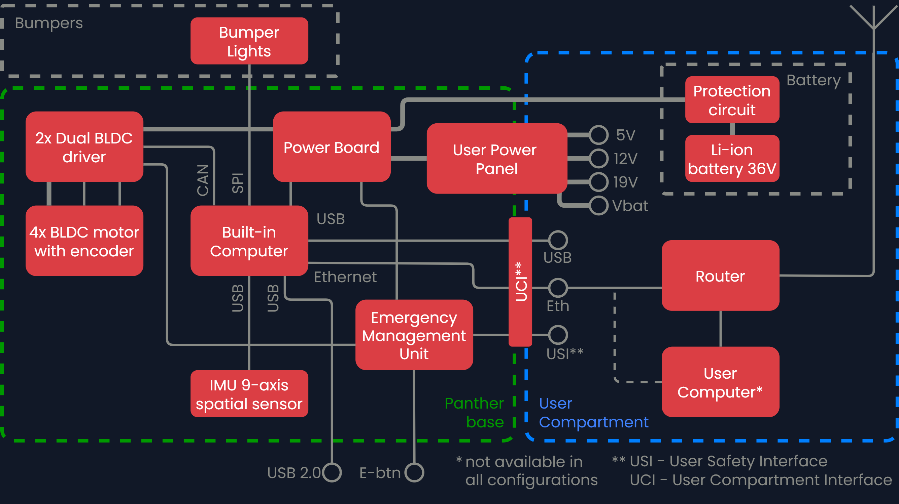
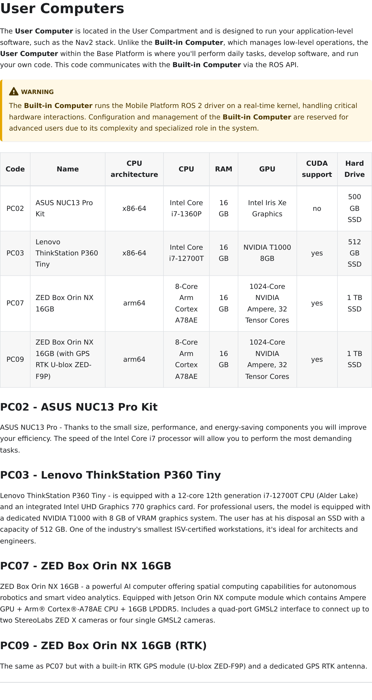

# Husarion Panther 整車硬體與控制整合

Panther 是 Husarion 的戶外無人地面載具（UGV）平台。使用者電腦（User Computer）執行導航與應用程式，內建電腦（Built-in Computer）執行底盤驅動，再由馬達控制器控制車輪。硬體急停由緊急管理單元（EMU）處理。應用程式透過 ROS 介面控制底盤；加裝設備時，還要核對機構、供電與急停接線的版本。[官方概觀與軟體說明](https://husarion.com/manuals/panther/)。

查閱日期：2026-10-01。硬體內容以官方手冊 Panther v1.2／v1.2x 分頁為主；ROS 2 API 標示支援 Panther v1.2 以上。涉及 v1.0–v1.06、v1.23 的新增部件或 v1.3x 的安全介面時，會在相關段落註明。本文依官方文件整理，未做整車實測。

## 閱讀順序

1. [車輛硬體基本資訊](#1-車輛硬體基本資訊)
2. [系統方塊圖與內部控制板](#2-系統方塊圖與內部控制板)
3. [內建電腦與 User Computer 如何互動](#3-內建電腦與-user-computer-如何互動)
4. [安裝導軌與上裝控制注意事項](#4-安裝導軌與上裝控制注意事項)
5. [整合前要確認的資料](#5-整合前要確認的資料)

## 1 車輛硬體基本資訊

### 1.1 尺寸與移動能力

下表以 WH01 充氣輪、單電池配置為準。換輪、換電池或加裝電腦與上裝後，需重新確認整車重量與外形。[官方規格](https://husarion.com/manuals/panther/#specification)。

| 項目 | 官方數值／配置 |
|---|---|
| 長 × 寬 × 總高 | 809 × 848 × 370 mm |
| 平台高度 | 356 mm |
| 軸距／輪距 | 440／695 mm |
| 最小／最大離地間隙 | 141／158 mm |
| 基準重量 | 55 kg |
| 最大速度／最大載重 | 2 m/s／120 kg |
| 防護選項 | IP54 或 IP66；第三方上裝須另外確認防護 |
| 運作／儲存溫度 | −20～50 °C |
| 充電溫度 | 0～45 °C |

WH01 為直徑 370 mm 的越野充氣輪，建議胎壓 1.0～1.5 bar；WH02 為直徑 203 mm 的麥克納姆輪（Mecanum）。兩種輪型適用的地形與運動學不同，換輪時也要更改對應的控制設定。[輪型選項](https://husarion.com/manuals/panther/panther-options/#wheels)、[輪型設定](https://husarion.com/manuals/panther/software/ros2/robot-management/#changing-wheel-type)。

官方牽引規格列出爬坡 80%（39°），並提供不同載重下的爬坡結果。最大載重、速度與坡度各有條件，不能假設三者可同時達到。從整合角度看，高設備或手臂會改變重心與動態力矩，仍需按坡向與實際載荷驗證抗傾覆能力。[官方牽引規格](https://husarion.com/manuals/panther/#specification)。

### 1.2 馬達、感測器與車內空間

| 部件 | 配置與用途 |
|---|---|
| 驅動馬達 | 4 顆無刷馬達＋行星減速機；手冊型號 `80PMB800K.80RBL-100`，每顆 473 W、瞬時 900 W，標稱減速比 30:1 |
| 馬達編碼器 | 4 顆正交光學編碼器，手冊標示 400 cpr；控制器實際解碼設定須依驅動參數確認 |
| 慣性感測器（IMU） | PhidgetSpatial 3/3/3 Precision；加速度、角速度及磁場各三軸 |
| 內建電腦 | 四核心 64 位元、1.5 GHz、4 GB RAM；執行基本車體功能 |
| 網路路由器 | 標準 Teltonika RUTX11；內部 Ethernet、2.4／5 GHz Wi-Fi，行動網路與 GNSS 依天線及選項配置 |
| 前後燈條 | APA102C 可程式化 RGB 指示燈，用於車況、電量與錯誤提示 |
| 使用者艙 | BAT01 約 13.6 L；BAT02 約 10.0 L，電腦與路由器安裝在使用者托架（User Shelf） |

部件與尺寸來源：[Components](https://husarion.com/manuals/panther/#components)、[User Shelf](https://husarion.com/manuals/panther/#user-shelf)。設定編碼器前，先確認手冊的 cpr 與 ROS 驅動的 `encoder_resolution` 是否採用相同計數方式；表內數值不宜直接填入控制器參數。[官方硬體介面參數](https://husarion.com/manuals/panther/software/ros2/packages-overview/#ugvsystem-panthersystem--lynxsystem)。

### 1.3 電池與上裝供電

| 電池選項 | BAT01 | BAT02 |
|---|---|---|
| 額定電壓／容量 | 36 V／20 Ah | 36 V／40 Ah |
| 能量 | 720 Wh | 1440 Wh |
| 官方續航範圍 | 3.5～8 h | 7～16 h |
| 官方待機時間 | 40 h | 80 h |

表內續航範圍來自手冊，實際結果受感測器、GPU、載重與地形影響。BAT02 佔用較多艙內空間，官方明列它無法與 PC03 Lenovo ThinkStation P360 Tiny 配置並用。[電池資料](https://husarion.com/manuals/panther/#battery--charging)、[BAT02 配置限制](https://husarion.com/manuals/panther/panther-options/#bat02---1440wh)。

v1.2 使用者電源面板（User Power Panel）的限制如下。每組電壓的電流上限由該組所有插座共用。[官方面板說明](https://husarion.com/manuals/panther/#user-power-panel)。

| 電源線 | 上限 | 使用注意 |
|---|---|---|
| 5 V | 合計 15 A，3 個 XT60 | 與 12 V、19 V 一起受 360 W 總功率限制 |
| 12 V | 合計 25 A，3 個 XT60 | 標準路由器使用其中一個輸出 |
| 19 V | 合計 10 A，3 個 XT60 | 選配 User Computer 使用其中一個輸出 |
| 輔助電源（AUX Power） | 電池電壓 32～42 V，最高 10 A | 預設關閉，以 `hardware/aux_power_enable` 服務切換；不是穩壓 36 V |

面板最高供電為 720 W，其中 5／12／19 V 三組穩壓電源合計限 360 W。v1.0–v1.06 的舊面板則有 9 個 XT60，12 V 合計 20 A、總功率 360 W，沒有新款的 AUX 配置。充電時禁止駕駛 Panther；正常關機應使用電源按鈕，直接切電池開關可能造成電腦資料遺失。[供電與版本分頁](https://husarion.com/manuals/panther/#user-power-panel)、[充電限制](https://husarion.com/manuals/panther/#charging-panther)。

## 2 系統方塊圖與內部控制板

### 2.1 官方系統方塊圖

圖源：[Husarion Panther 手冊 Block Diagram，v1.2 分頁](https://husarion.com/manuals/panther/#block-diagram)。官方原圖為透明底白字，這裡加上瀏覽器深色背景後截圖，方便閱讀；另保留[官方原始 PNG](../../img/husarion-panther-block-diagram-original.png)。圖中可看出硬體連接關係，接腳與接線細節則需查對應修訂版的圖面。

圖中的連接可分成三條路徑：

| 路徑 | 元件走向 | 開發者要知道的事 |
|---|---|---|
| 應用與車體資料 | User Computer ↔ RUTX11 ↔ Built-in Computer | 兩台 Linux 電腦透過 Ethernet 網路使用 ROS 介面 |
| 車輪控制 | Built-in Computer ↔ CAN ↔ 前、後馬達控制器 ↔ 4 顆馬達／編碼器 | 車體速度先換算成輪指令，底盤驅動負責內部硬體通訊 |
| 電源與安全 | 電池、Power Board、電壓轉換器、EMU／Safety Board、使用者面板 | 供電能力、急停條件與應用資料通訊分別核對 |

控制路徑參照[官方 ROS 2 系統設計](https://husarion.com/manuals/panther/ros2-api/#ros-2-system-design)及[硬體介面套件](https://husarion.com/manuals/panther/software/ros2/packages-overview/#husarion_ugv_hardware_interfaces)。

### 2.2 各控制單元做什麼

| 單元 | 職責與互動方式 |
|---|---|
| User Computer | 執行 Nav2、建圖、視覺及自訂應用；輸出車體速度、讀取里程與狀態 |
| Built-in Computer | 在具即時核心的 Ubuntu 系統執行底盤 ROS 2 驅動；管理 CAN、GPIO、感測資料與車體狀態 |
| 前、後馬達控制器 | 接受內建電腦的馬達指令並回報狀態；官方 ROS 2 介面含 Roboteq 控制器資料與 CANopen 配置 |
| Power Board／轉換器 | 控制車體電源，提供各組電壓輸出 |
| EMU／Safety Board | 接收急停、CPU 看門狗（Watchdog）與驅動故障；依硬體開關設定煞車、鎖存急停及切換外部繼電器 |

前方維修艙含電源轉換器與前馬達控制器，後方含內建電腦、Power Board、後馬達控制器及其他電路；日常軟體開發通常不需開啟維修艙。[Service Spaces](https://husarion.com/manuals/panther/#service-spaces)、[EMU 官方說明](https://husarion.com/manuals/panther/panther-emu/)。

## 3 內建電腦與 User Computer 如何互動

### 3.1 官方建議／提供的電腦配置

Panther 選項頁列出以下 User Computer 配置：

截圖來源：[Panther Configuration Options — User Computers](https://husarion.com/manuals/panther/panther-options/#user-computers)。

| 代碼／產品 | CPU／架構 | RAM／儲存 | GPU／額外功能 |
|---|---|---|---|
| PC02 ASUS NUC13 Pro Kit | Core i7-1360P／x86-64 | 16 GB／500 GB SSD | Intel Iris Xe；無 CUDA |
| PC03 Lenovo ThinkStation P360 Tiny | Core i7-12700T／x86-64 | 16 GB／512 GB SSD | NVIDIA T1000 8 GB；支援 CUDA |
| PC07 ZED Box Orin NX 16GB | 8 核心 Cortex-A78AE／arm64 | 16 GB／1 TB SSD | NVIDIA Ampere；支援 CUDA、GMSL2 相機介面 |
| PC09 ZED Box Orin NX 16GB RTK | 同 PC07 | 16 GB／1 TB SSD | 加入 U-blox ZED-F9P RTK GNSS 與專用天線 |

官方主手冊的 Components 段落將 Jetson 儲存寫成 512 GB，選項頁 PC07／PC09 表格則為 1 TB；上表採用型號較明確的選項頁，實際出貨配置仍須核對訂單。PC03 另有前述 BAT02 空間限制。[選項頁](https://husarion.com/manuals/panther/panther-options/#user-computers)、[主手冊部件表](https://husarion.com/manuals/panther/#components)。

自備電腦須有 Ethernet、相容供電及足夠的運算資源。官方 x64 配置有預裝環境；ZED Box 不提供 Husarion OS 映像檔，依官方指引使用 NVIDIA JetPack，再完成相容的 ROS 設定。[User Computer Setup Guide](https://husarion.com/manuals/panther/software/user_computer/setup/)。

### 3.2 網路與控制資料流

標準內部網段為 `10.15.20.0/24`：

| 裝置 | 官方預設 IP |
|---|---|
| RUTX11 路由器 | `10.15.20.1` |
| Built-in Computer | `10.15.20.2` |
| User Computer | `10.15.20.3` |

User Computer 的 Ethernet 線接路由器，再與內建電腦交換 ROS 資料。自訂配置需核對 ROS 發行版、名稱空間（Namespace）、DDS 發現與容器網路；能 ping 通只證明 IP 連線，還需確認能看見正確的主題與服務。IP 來源：[官方網路設定](https://husarion.com/manuals/husarion_ugv/wifi-connection/#network-setup)。

自主移動時，指令與回授依下列路徑傳遞：

1. User Computer 上的導航軟體計算車體線速度與角速度。
2. 透過 ROS 2 速度主題送到內建電腦；速度來源由驅動仲裁。
3. `drive_controller` 按差速或麥克納姆配置，把車體速度換成輪指令。
4. 硬體介面經 CAN 與前後馬達控制器溝通。
5. 車輪回授產生里程資料，並搭配 IMU 等感測資料提供給應用程式。

應用程式可透過公開 ROS 介面使用這條控制鏈。若要直接接管 CAN 或更改控制器配置，需一併處理底盤驅動與安全條件。[ROS 2 API](https://husarion.com/manuals/panther/ros2-api/)。

### 3.3 常用 ROS 2 介面

以下名稱以官方 API 的相對名稱呈現。若車輛使用 `/panther` 名稱空間，例如 `cmd_vel` 的完整名稱為 `/panther/cmd_vel`；請以實際 `ros2 topic list`、`ros2 topic info` 與 `ros2 service list` 核對。[官方 API](https://husarion.com/manuals/panther/ros2-api/#ros-interfaces)。

| 介面 | 用途／訊息型別 |
|---|---|
| `autonomous/cmd_vel`、`manual/cmd_vel`、`cmd_vel` | 自主、手動及其他來源的速度輸入；現行 API 表使用 `geometry_msgs/msg/TwistStamped` |
| `odometry/wheels`、`odometry/filtered` | 輪式里程與融合後里程；`nav_msgs/msg/Odometry` |
| `imu/data` | IMU 資料；`sensor_msgs/msg/Imu` |
| `battery/battery_status` | 電池狀態；`sensor_msgs/msg/BatteryState` |
| `hardware/e_stop` | 急停狀態；`std_msgs/msg/Bool` |
| `hardware/robot_driver_state`、`diagnostics` | 馬達控制器狀態與診斷 |
| `hardware/e_stop_trigger`、`hardware/e_stop_reset` | 觸發／解除急停服務；`std_srvs/srv/Trigger` |
| `hardware/aux_power_enable`、`hardware/fan_enable` | 輔助供電／風扇控制服務；`std_srvs/srv/SetBool` |

Jazzy 使用帶時間戳的速度訊息，Humble 的操作範例使用 `Twist`。自訂控制系統需至少以 10 Hz 發送指令；官方管理文件說明超過 0.2 s 未收到指令會停車。解除急停前先停止速度發布；解除後再恢復指令。多來源的輸入應走各自的仲裁介面，避免多個發布者搶同一條速度輸入。[遠端控制條件與訊息版本](https://husarion.com/manuals/panther/software/ros2/robot-management/#remote-control)。

### 3.4 時間同步、關機與急停

內建電腦提供 Chrony 時間來源，User Computer 應同步到 `10.15.20.2`。自備電腦還需設定正常關機整合：按車體電源按鈕後，內建電腦可先請 User Computer 關機，再關閉自身與車體電源。[時間同步與關機設定](https://husarion.com/manuals/panther/software/user_computer/setup/#time-synchronization)。

EMU 看門狗監控內建電腦與安全單元之間的通訊。User Computer 應用程式的健康狀態需另行檢查；應用停止輸出速度時，由相應的指令逾時機制處理。[EMU CPU Watchdog](https://husarion.com/manuals/panther/panther-emu/#cpu-watchdog)。

v1.2 的預設急停動作包括主動煞車、鎖存急停及切換外部單刀雙擲繼電器（SPDT）。AUX 與整車電源是否切斷，由 Safety Board 的開關設定決定：SW1-02 的 AUX 急停連動預設關閉，SW1-04 的急停立即斷整車電源也預設關閉，因此按下急停後，上裝可能仍有供電。舊版 v1.0–v1.06 手冊則描述急停會切斷整車電源。[EMU 開關表](https://husarion.com/manuals/panther/panther-emu/#switches-at-a-glance)、[車體急停版本分頁](https://husarion.com/manuals/panther/#emergency-button)。

## 4 安裝導軌與上裝控制注意事項

### 4.1 導軌結構與固定

車頂的安裝導軌（Mounting Rails）採用 V-slot 2020 鋁型材，用來固定感測器、載荷與設備。手冊說明如何固定與翻起導軌，未列出導軌本身的致動器或 ROS 控制介面。[Mounting Rails](https://husarion.com/manuals/panther/#mounting-rails)。

| 項目 | 官方說明 |
|---|---|
| 上裝固定方式 | 使用對應型材的 T 型螺帽、角件與連接件 |
| 導軌與車體連接 | 4 支 `ISO 7379 M6×30` 肩螺絲，搭配 `DIN 986 M6` 尼龍防鬆螺帽 |
| 翻起開艙 | 拆前端或後端的 2 支肩螺絲及 2 顆螺帽，以另一端作支點 |
| 最大開啟角度 | 160°，有內建限位 |
| 防護 | 導軌本身的存在不影響車體防水防塵；穿殼與上裝的密封須另確認 |

這一段手冊未提供 M6 肩螺絲的鎖固扭矩、導軌局部點載重或允許傾覆力矩。下節的 4～5 N·m 適用於上蓋螺絲；整車 120 kg 的載重額度也不等於導軌任意單點的承重，兩者都不能代入導軌固定計算。

### 4.2 翻起導軌與開蓋維修

開艙時先翻起導軌，再拆上蓋。IP54 上蓋有 8 支、IP66 有 18 支 `DIN 912 M5×12` 螺絲。裝回前清潔密封面，上蓋螺絲以 4～5 N·m 鎖固。[使用者艙開啟說明](https://husarion.com/manuals/panther/#access-to-the-user-compartment)。

為了讓加裝設備後仍可正常開艙，建議在整合時檢查以下項目：

- 在鬆開導軌固定件前，先固定或卸下會滑動的載荷，並支撐可能因重心偏移而自行翻落的上裝。
- 配線保留翻起需要的活動餘量與彎曲半徑；檢查整段行程，避免線材拉住導軌、接頭承受重量或線材夾進鉸接處。
- 安裝位置保留上蓋、螺絲與電池拆換路徑；跨在兩端的上裝架要確認可翻起或可先拆除。
- 160° 是開啟限位，不能據此推定限位件能支撐任意上裝重量。

涉及內部元件的維修，官方要求先取出電池；把 Battery Switch 轉到 OFF 不能代替取出電池。[內部維修注意事項](https://husarion.com/manuals/panther/#service-spaces)。

### 4.3 導軌上的設備怎麼供電與控制

導軌負責機械固定，上裝的資料與供電則需另外接線。資料線接到 User Computer 或對應控制器，電源線接到符合設備需求的輸出。依設備規格選擇 Ethernet、USB 或其他選配介面，再將驅動與設備相對車體的座標轉換加入應用程式。[官方通訊選項](https://husarion.com/manuals/panther/#communication)、[User Computer 要求](https://husarion.com/manuals/panther/software/user_computer/setup/#requirements)。

上裝若需與車體共同急停，可透過使用者安全介面（USI）的繼電器輸出設計連動。接點額定為 1 A @ 24 V DC 或 0.5 A @ 125 V AC，適合連接設備的安全控制輸入或合適的外部電路；大功率上裝的電源切換需另設電路。[USI 繼電器輸出](https://husarion.com/manuals/panther/panther-emu/#spdt-relay-output)。

USI 的急停觸發接法隨版本而異：官方 v1.2x 說明為對端子施加 3～12 V；v1.3x 則使用正常閉合迴路，斷開即急停。兩種接法不可混用，接線前需核對車體版本、手冊分頁與接腳圖。更改 EMU 設定後，依官方要求實際觸發、解除急停，確認上裝與底盤的反應。[USI 輸入及設定驗證](https://husarion.com/manuals/panther/panther-emu/#user-e-stop-trigger-input)。

### 4.4 出線、重心與行駛設定

官方採用電纜固定頭（Cable Gland）穿過上蓋。固定頭及密封件需符合車體防護等級；孔位避免與艙內設備和導軌碰撞。鑽孔時將上蓋取離車體，在外部加工、去毛邊後再裝回，避免金屬屑落入電路。[穿殼配線說明](https://husarion.com/manuals/panther/#running-cables-through-cover)。

導軌加裝 LiDAR、相機、支柱或手臂後，建議更新設備相對車體的座標轉換（TF）、車體占地輪廓（Footprint）與碰撞模型，並按新的重心與設備慣性驗證速度、加速度、轉彎及坡面行駛。初次測試從低速開始，分別觀察直行、轉向、停車與急停時上裝的反應。[相關原理：底盤與手臂的耦合](../20-forms/mobile-manipulator/mobile-manipulation.md)。

加高架 DEV04 可提高安裝面。官方要求在 DEV04 上安裝機械手臂時，客製加厚頂端導軌；即使未超過整車載重，仍需遵守這項固定結構要求。[DEV04 選項說明](https://husarion.com/manuals/panther/panther-options/#dev04---170-mm-or-370mm-high-frame-for-sensors)。

## 5 整合前要確認的資料

| 待確認資料 | 原因 |
|---|---|
| 車體修訂版、輪型、電池與防護選項 | 影響尺寸、供電、安裝及急停契約 |
| User Computer 型號與實際儲存容量 | 官方不同頁面有配置差異，依訂單與實機確認 |
| ROS 發行版、驅動版號及名稱空間 | 影響速度訊息型別與介面名稱 |
| 上裝重量、重心、固定點及急停需求 | 整車額定載重不足以證明導軌局部承載或動態穩定 |
| M6 固定件扭矩與上裝力矩限制 | 本次官方段落沒有足夠數值，需查對應圖面或詢問原廠 |

延伸入口：[官方主手冊與 CAD／圖面](https://husarion.com/manuals/panther/#docs-and-links)、[ROS 2 驅動原始碼](https://github.com/husarion/husarion_ugv_ros)、[同系列 ROSbot XL 專章](husarion-rosbot-xl.md)、[兩種控制架構的 SWOT](husarion-control-architecture-swot.md)、[產品索引與截圖重生方式](README.md)。
