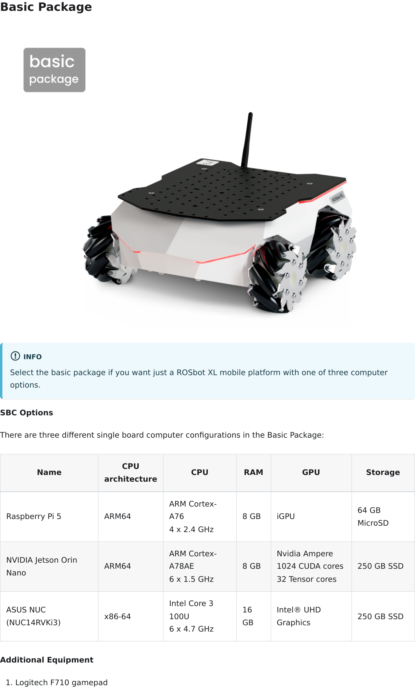
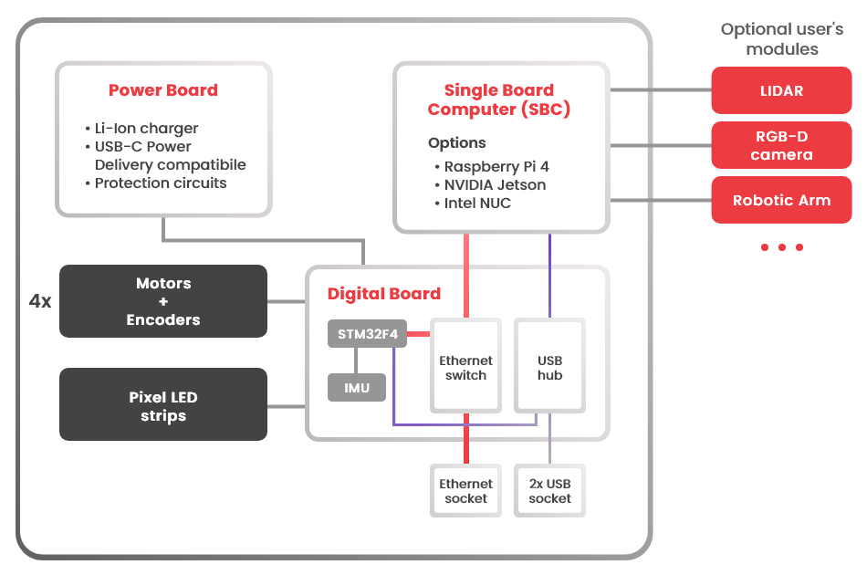

# Husarion ROSbot XL 整車硬體與控制整合

ROSbot XL 是 Husarion 的四輪教育與研究平台。Linux 車載電腦執行 ROS 2、導航與感測器應用，透過 Ethernet 與數位控制板（Digital Board）交換控制資料。板上的微控制器（MCU）STM32F407 連接馬達、編碼器及 IMU；電源板（Power Board）處理電池、充電與供電。[官方產品手冊](https://husarion.com/manuals/rosbot-xl/)。

查閱日期：2026-10-01。本文整理 ROSbot XL；ROSbot 2、3 屬於其他型號。手冊仍保留 Raspberry Pi 4 的舊圖與部分基準條件，現行配置頁則列 Raspberry Pi 5，因此硬體圖片、出貨配置與軟體版本需分別核對。本文未做整車實測。

## 閱讀順序

1. [車輛硬體基本資訊](#1-車輛硬體基本資訊)
2. [官方方塊圖與內部控制板](#2-官方方塊圖與內部控制板)
3. [車載電腦與 STM32 如何互動](#3-車載電腦與-stm32-如何互動)
4. [安裝板與擴充控制注意事項](#4-安裝板與擴充控制注意事項)

## 1 車輛硬體基本資訊

### 1.1 車體與驅動規格

| 項目 | 官方規格 |
|---|---|
| 長 × 寬 × 高 | 332 × 325 × 133.5 mm；不含相機與 LiDAR |
| 輪徑／離地間隙／軸距 | 100／32／170 mm |
| 材質 | 粉體塗裝鋁板，車殼 1.5 mm、上板 3 mm |
| 基準重量 | 5.38 kg |
| 最大線速度／角速度 | 0.8 m/s／180°/s（3.14 rad/s） |
| 最大載重 | 最高 10 kg |
| 續航 | 約 2～6 h |
| 輪型 | 一般輪與麥克納姆輪（Mecanum），隨車提供兩套 |

手冊的重量與載重數值以麥克納姆輪、RPi4、無感測器為條件。現行 RPi5、NUC 或手臂套件需按實際配置重新確認重量、上板負載，以及手臂伸展和轉彎時的穩定性。[官方規格與註腳](https://husarion.com/manuals/rosbot-xl/#specification)。

| 部件 | 官方配置 |
|---|---|
| 馬達 | 4 顆 Xinhe XH-37D 有刷直流馬達，12 V；減速比 50:1 |
| 馬達能力 | 每顆最大機械功率 10 W；輸出軸空載約 200 rpm；堵轉力矩 21 kg·cm，堵轉電流 5.4 A |
| 編碼器 | 每顆馬達有磁性正交編碼器；手冊標示 64 cpr、16 poles |
| IMU | BNO055 九軸姿態感測器 |
| 控制板 | Digital Board，STM32F407 |
| 電池 | 3S 鋰離子，11.1 V、7.8 Ah，約 86 Wh |
| 後面板 | 2 個 USB 2.0、HDMI、Ethernet、電源／重設／使用者按鈕、狀態燈及 USB-C 供電 |

部件來源：[Components](https://husarion.com/manuals/rosbot-xl/#components)、[後面板](https://husarion.com/manuals/rosbot-xl/#rear-panel-description)。堵轉數值描述馬達的極限狀態，不宜用作持續運轉的設計值。估算供電時，需合計四顆馬達、電腦與擴充設備的負載。

### 1.2 官方提供的車載電腦配置

[](../../img/husarion-rosbot-xl-computers.png)

下表與截圖取自官方的[基本套件配置頁](https://husarion.com/manuals/rosbot-xl/rosbot-xl-options/#basic-package)。

| 型號 | CPU／架構 | RAM／儲存 | GPU |
|---|---|---|---|
| Raspberry Pi 5 | Cortex-A76，4 核心 2.4 GHz／ARM64 | 8 GB／64 GB microSD | 內建 GPU |
| NVIDIA Jetson Orin Nano | Cortex-A78AE，6 核心／ARM64 | 8 GB／250 GB SSD | Ampere，1024 CUDA 核心、32 Tensor 核心 |
| ASUS NUC `NUC14RVKi3` | Intel Core 3 100U／x86-64 | 16 GB／250 GB SSD | Intel UHD Graphics |

官方預配置的 Telepresence、Autonomy 與 Manipulation 套件使用 NUC；Manipulation PRO 使用 Jetson Orin Nano。相機、LiDAR 與手臂是否隨附，需查所選套件的配備清單。[官方套件配置](https://husarion.com/manuals/rosbot-xl/rosbot-xl-options/)。

### 1.3 電池與充電

電源板支援 USB-C 電力傳輸協定（Power Delivery，PD），輸入範圍 12～20 V。標準充電器為 65 W；官方另說明替代充電器需支援 PD2.0／PD3.0 的 15 V 或 20 V、至少 3 A。ROSbot XL 可以在供電並充電的模式下運作，電池會在負載超過外部電源能力時補足電力。[充電模式](https://husarion.com/manuals/rosbot-xl/#charging)。

電池電壓範圍為 9～12.6 V；官方電池表列最大放電 8 A、最大充電 2.7 A，充電溫度 0～45 °C。關機充電約需 5～6 h。Panther 使用 36 V 電池，充電操作限制也不同，整合時需分別查閱。[Battery & Charger Parameters](https://husarion.com/manuals/rosbot-xl/#battery--charger-parameters)。

## 2 官方方塊圖與內部控制板

[](../../img/husarion-rosbot-xl-block-diagram.png)

圖源：[官方 Block Diagram](https://husarion.com/manuals/rosbot-xl/#block-diagram)。原圖列 Raspberry Pi 4、Jetson 與 Intel NUC，適合用來看整體架構；現行電腦配置見前表。更詳細的[官方 PDF](https://docs-new.s3.eu-west-1.amazonaws.com/pdf/ROSbot_XL_block_diagram_RPi.pdf)標示 RPi4 rev B，查現行 RPi5 接線時，仍需核對對應圖面。

| 單元 | 做什麼 | 與其他元件怎麼接 |
|---|---|---|
| 車載電腦（官方稱 SBC） | 執行 ROS 2 驅動、車體運動學、導航與感知 | Ethernet 連數位板；USB 等介面接感測器 |
| Digital Board | STM32F407、馬達驅動、編碼器讀取、IMU、燈號與擴充接腳 | STM32 連車內 Ethernet switch；板上電路連馬達與其他周邊 |
| Power Board | 電池保護、USB-C PD 充電與電壓供應 | 供電給電腦、控制板及使用者設備 |
| Ethernet switch | 連接電腦、STM32 與後面板網路插座 | 提供有線網路交換；與 Panther 標準 RUTX11 路由器的功能不同 |
| USB hub | 擴充車載電腦的 USB 連接 | 提供內外部 USB 接口；底盤通訊另走 Ethernet |

Digital Board 位於車體後端，Power Board 沿右側垂直安裝。詳細圖將馬達驅動列在 Digital Board 內，輪子控制由 STM32 韌體與板上馬達驅動電路共同完成。[內部板卡說明](https://husarion.com/manuals/rosbot-xl/#user-compartment)、[詳細方塊圖](https://docs-new.s3.eu-west-1.amazonaws.com/pdf/ROSbot_XL_block_diagram_RPi.pdf)。

## 3 車載電腦與 STM32 如何互動

### 3.1 控制鏈與責任分工

```text
車載電腦上的 Nav2／手動控制／自訂應用
    ↓ 車體速度（前進、側移、旋轉）
ROS 2 速度仲裁與差速／麥克納姆控制器
    ↓ 各輪速度命令
硬體介面＋MCU 通訊橋接
    ↕ Ethernet
STM32F407 韌體＋板上馬達驅動電路
    ↕ 馬達、編碼器、IMU
輪子動作與硬體回授
```

車載電腦上的 ROS 2 節點負責將車體速度換算成各輪命令，並計算里程與融合感測資料；STM32 韌體負責馬達與感測器的硬體側控制。查控制功能時，要依節點與韌體介面的職責定位，運動學與里程計算並未全部移到 MCU。[官方 ROS 2 軟體說明](https://husarion.com/manuals/rosbot-xl/ros2-api/)、[ROS 驅動硬體介面說明](https://github.com/husarion/rosbot_ros/blob/jazzy/ARCHITECTURE.md#rosbot_hardware_interfaces--ros2_control-plugins-c)。

### 3.2 Ethernet 與上層通訊協定要分開看

Ethernet 提供電腦與數位板的硬體連線，MCU 與 ROS 2 之間則靠通訊協定及橋接程式交換資料。本次查閱的官方 `rosbot_ros` README 說明，MCU 使用 MAVLink 與 `rosbot_mavlink_bridge` 互動；micro-ROS 支援至 `v2.1.0-jazzy`，`v2.2.0-jazzy` 與相應驅動已不再隨附 micro-ROS。閱讀舊文件的「Ethernet＋micro-ROS」時，需先核對適用版本。[官方現行 README](https://github.com/husarion/rosbot_ros#run-the-robot)。

主手冊的 Software 段落仍連到 `rosbot_xl_ros`；該儲存庫已於 2025-08-05 封存，README 指向新的 `husarion/rosbot_ros`。查最新驅動與控制介面時，從新儲存庫進入；查舊機台則依其已安裝版本處理。[舊儲存庫的遷移說明](https://github.com/husarion/rosbot_xl_ros)、[現行驅動入口](https://github.com/husarion/rosbot_ros)。

更換 ROS 發行版、驅動、容器或電腦時，需依官方要求配對相容的 MCU 韌體。更新前記錄電腦端 ROS／驅動版號、MCU 韌體版號與橋接方式，再按該版本的官方流程更新。[官方版本配對要求](https://github.com/husarion/rosbot_ros#run-the-robot)。

### 3.3 常用控制與狀態介面

以下是現行 Jazzy 文件的相對名稱，啟用名稱空間後會加上車輛前綴。舊驅動的主題名稱與訊息型別可能不同，先用 `ros2 topic list` 及 `ros2 topic info` 核對。[官方 ROS API](https://github.com/husarion/rosbot_ros/blob/jazzy/ROS_API.md)。

| 介面 | 用途 |
|---|---|
| `manual/cmd_vel` | 手動速度輸入，優先權 100 |
| `autonomous/cmd_vel` | 自主導航速度輸入，優先權 10 |
| `cmd_vel` | 未分類來源，優先權 1 |
| `twist_mux_controller/source` | 目前取得控制權的來源 |
| `odometry/wheels`、`odometry/filtered` | 輪式里程、融合里程 |
| `joint_states`、`imu/data`、`diagnostics` | 車輪關節、IMU 與診斷資料 |

現行速度介面使用 `geometry_msgs/msg/TwistStamped`，仲裁器選擇最近 0.2 s 內有發布指令、且優先權最高的來源。放開手把只會停止手動輸入，自主來源可能隨即重新取得控制權；要讓整車停下，需連同其他速度來源一起管理。[速度來源仲裁](https://husarion.com/manuals/rosbot-xl/ros2-api/#velocity-command-arbitration)。

### 3.4 啟動與故障定位

後面板 LED2 熄滅代表韌體指示正常；恆亮代表未與韌體通訊或 ROS 驅動未執行；閃爍代表低電量，會覆蓋前述指示。DB Reset 用來重新啟動數位板，PB Reset 用來重新啟動電源板；兩者是重設功能，不等同於 Panther 的 EMU 急停。[官方狀態燈與後面板](https://husarion.com/manuals/rosbot-xl/#led-statuses)。

除錯時，建議依序確認供電、電腦啟動、Ethernet 連線、韌體與橋接版本、ROS 控制器啟用狀態，以及目前速度來源，再檢查輪型與回授。先查通訊與軟體，再查機械與馬達，較容易找出故障位置。停止距離、MCU 失聯反應與獨立安全功能仍需按相應韌體實測；本文沒有安全認證的驗證資料。

## 4 安裝板與擴充控制注意事項

### 4.1 感測器與手臂安裝

ROSbot XL 以帶孔上蓋／通用安裝板擴充設備。安裝 Autonomy 套件時，先拆上蓋，固定相機與 LiDAR，再裝轉接器、接線，最後裝回上蓋。這款有自己的孔位與支架規格，不適用 Panther 的 V-slot 2020、M6 肩螺絲與 160° 翻起方式。[官方安裝說明](https://husarion.com/manuals/rosbot-xl/options/assembly/#autonomy-package-assembly)。

官方手臂套件另有軸承、底座與 Arm Board，安裝程序也包含 Arm Board 與 Power Board／Digital Board 的接線。選用其他手臂時，需另外確認固定結構，不能只依底盤載重判斷是否可直接鎖在上板。[Manipulation 安裝說明](https://husarion.com/manuals/rosbot-xl/options/assembly/#manipulation-package-assembly)。

整合時，建議檢查線材是否被上蓋或手臂底座夾住、是否碰到輪子，並保留通風與維修空間。新增設備後也要更新 TF、占地輪廓與碰撞模型，重新驗證手臂伸展、側移與轉彎的穩定性。

### 4.2 使用者供電與電壓切換

| 輸出 | 接腳內容 | 限制 |
|---|---|---|
| 電腦供電 CON9 | GND、12／19 V、Vbat2、5 V | 12 V 4.75 A／19 V 3 A；5 V 5 A，詳見接腳表 |
| 使用者供電 CON8 | GND、12／19 V、Vbat1、5 V | 各電源輸出表列 3 A；接頭為 JST XHP-4 |

CON8 與 CON9 共用 5 V、12／19 V 電源線，合計負載需控制在 CON9 的額度內。電池直出線也與其他電路共用電池，估算總功率時需計入這項限制。[官方 Power Board Items](https://husarion.com/manuals/rosbot-xl/#power-board-items)。

Power Board 的 SW1 第 3 段，OFF 為 12 V、ON 為 19 V；第 1、2 段官方註明不要變更。12／19 V 是同一接腳的選擇，不是兩條獨立輸出。換電腦前核對輸入電壓、接腳與極性，斷電後設定再接線。5 V 在另一接腳，不能靠這個開關把 12／19 V 接腳變成 5 V。[SW1 與 CON9 接腳表](https://husarion.com/manuals/rosbot-xl/#power-board-items)。

### 4.3 擴充 GPIO 與散熱

Digital Board 的 EXT1／EXT2 採用 3.3 V 邏輯，串有 220 Ω 電阻；部分 I²C 腳位需要外部上拉。EXT2 的 `CAN1_TX`／`CAN1_RX` 是 MCU 訊號，需按官方說明外接 CAN 收發器，才能連接 CANH／CANL。接腳上的 5 V 是供電，訊號腳仍需遵守邏輯電壓限制，不可直接輸入 5 V。[官方擴充接腳表](https://husarion.com/manuals/rosbot-xl/#digital-board-items)。

Digital Board 的 DIP_SW 第 1 段選喇叭來源，第 3 段選 MCU BOOT0：OFF 從 FLASH 啟動、ON 進入載入程式（Bootloader）。這個設定影響韌體啟動，與 Power Board 的同編號開關是不同元件。[Digital Board Items](https://husarion.com/manuals/rosbot-xl/#digital-board-items)。

上蓋穿孔與左側風扇負責散熱；手冊說明內部空氣溫度超過 35 °C 時啟動風扇，加裝大面積設備時需保留通風路徑。本次引用的官方頁面未提供整車 IP 等級，Panther 的 IP54／IP66 僅適用於其自身配置。[散熱說明](https://husarion.com/manuals/rosbot-xl/#fan)。

延伸入口：[官方主手冊與 CAD](https://husarion.com/manuals/rosbot-xl/#cad-models)、[現行 ROS 驅動](https://github.com/husarion/rosbot_ros)、[Panther 專章](husarion-panther.md)、[兩種控制架構的 SWOT](husarion-control-architecture-swot.md)、[產品索引與圖片來源](README.md)。
