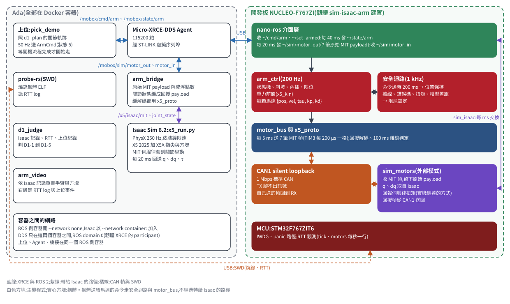
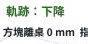
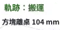

# 用開發板控制 ARX X5 模擬手臂夾取方塊

怎麼知道韌體真的夾起了東西？先讓 NUCLEO-F767ZI 控制 Isaac Sim 裡的六軸手臂，把邊長 5 cm 的方塊搬到 20 cm 外。讀取模擬器記錄的方塊位置，再用同一條軌跡重跑一次，這次讓夾爪保持張開。兩輪都有搬運命令，只有第一輪應該量到方塊離桌。

<a id="digital-shadow"></a>

## ARX X5 的數位影子如何參與控制？

夾爪接到「閉合」命令時，韌體只知道要馬達做什麼。下一步要知道關節轉到了哪裡，就得等量測值回來。這裡沿用本站「數位影子」（digital shadow）的用語，指板上隨回授更新的手臂狀態。控制器在實體開發板上，馬達、手臂和方塊由 Isaac Sim 模擬。命令與回授都自動傳送，整套實驗屬於硬體在迴路（hardware-in-the-loop）測試。[本站對數位影子的用語說明](digital-shadow-firmware-isaac-tb3.md)



沿圖追一次夾爪閉合時的資料流。

1. 上位程式 `pick_demo` 每 20 ms 送出一組關節目標。ROS 2 訊息 `ArmCmd` 經 Micro-XRCE-DDS Agent 與 USB 序列埠送進開發板。
2. 板上 Rust 韌體每 5 ms 為六個關節與夾爪計算馬達命令。CAN1 使用內部迴送，模擬馬達收到 CAN 幀後，把原始資料轉給主機的 `arm_bridge`。
3. Isaac Sim 以 250 Hz 計算關節與物體的運動。橋接程式每 20 ms 把關節位置、速度與扭矩編成馬達回授格式，經序列埠送回開發板。
4. 板上的模擬馬達將回授送進 CAN1，韌體沿用正式的馬達解碼路徑更新關節狀態。D1 每 40 ms 透過 `ArmState` 將板上狀態回報給上位程式。

### 從影片讀出方塊何時離桌

下面三張截圖來自同一輪 D1 影片，依序截取軌跡名稱與方塊離桌高度。軌跡名稱是上位程式正在執行的步驟，高度取自 Isaac 的物理紀錄。高度用於驗證夾取成果；回送給韌體的是關節位置、速度與扭矩。

| 00:13.28　接近方塊 | 00:19.08　夾持搬運 | 00:24.48　放下後撤離 |
|---|---|---|
|  |  |  |

最後一格最能看出兩者的差別。軌跡寫著「抬起」，但夾爪此時已鬆開，方塊留在桌上。要確認它落在指定位置，還要看同輪的水平放置誤差，這一輪量到 1.6 mm。

## 重跑 D1 夾取實驗

以下命令適用於已接好 NUCLEO-F767ZI、備妥模型及專案 Docker 環境的工作樹。先在 `mobox-arx-x5` 根目錄建置模擬版韌體與橋接程式。首次建置橋接程式時用 `FETCH=1` 下載相依套件。

```bash
bash tools/board/build-isaac.sh
FETCH=1 bash tools/isaac/build-bridge.sh
```

在接板並執行 Isaac Sim 的 Ada 主機上，從同一專案根目錄執行九輪測試。每次使用新的收據名稱。

```bash
PATH="$PWD/bin:$PATH" bash tools/isaac/d1-check.sh d1-example-01
cat runs/d1-example-01/verdict.txt
```

| 案例，各跑三輪 | 2026 年 11 月 20 日正式輪觀察 |
|---|---|
| 每 20 ms 送一個平滑軌跡目標 | 三輪均抬高約 104 mm，放置誤差 1.5 至 1.6 mm |
| 每段只送終點 | 峰值速度升至約 7.6 rad/s，三輪都超出平滑度判準，其中兩輪掉落 |
| 夾爪保持張開 | 三輪的方塊都留在桌面 |


正常第一輪影片第 19 秒。此時已進入搬運段，板上紀錄顯示控制器已解鎖，命令持續抵達。方塊位移另由模擬器量測，這一輪抬高 104.5 mm，放置誤差 1.6 mm。實驗使用實體控制板與模擬手臂。

實驗來源為 `mobox-arx-x5` 的 `docs/plan/D1-pick.md` 與 `runs/d1-20261120a`，韌體版本為 `11ad91f`。
