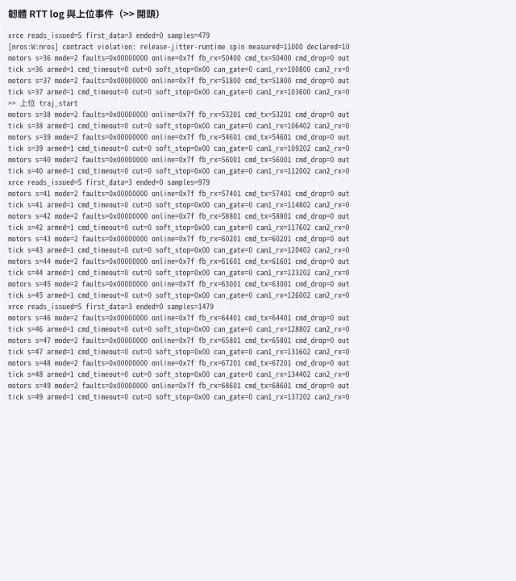
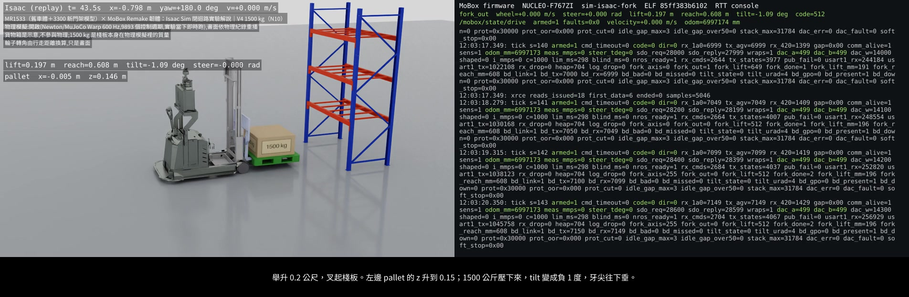

# 用開發板控制 ARX X5 模擬手臂夾取方塊

怎麼知道韌體真的夾起了東西？先讓 NUCLEO-F767ZI 控制 Isaac Sim 裡的六軸手臂，把邊長 5 cm 的方塊搬到 20 cm 外。讀取模擬器記錄的方塊位置，再用同一條軌跡重跑一次，這次讓夾爪保持張開。兩輪都有搬運命令，只有第一輪應該量到方塊離桌。

## 接通命令與回授

1. 上位程式 `pick_demo` 每 20 ms 送出一組關節目標。ROS 2 訊息 `ArmCmd` 經 Micro-XRCE-DDS Agent 與 USB 序列埠送進開發板。
2. 板上 Rust 韌體每 5 ms 為六個關節與夾爪計算馬達命令。CAN1 使用內部迴送，模擬馬達收到 CAN 幀後，把原始資料轉給主機的 `arm_bridge`。
3. Isaac Sim 依命令計算關節與物體的運動。橋接程式每 20 ms 把關節位置、速度與扭矩送回開發板。韌體從 CAN1 解碼回授，下一輪控制就能使用這次運動的結果。

## 重跑 D1 夾取實驗

以下命令適用於已接好 NUCLEO-F767ZI、備妥模型及專案 Docker 環境的工作樹。先在 `mobox-arx-x5` 根目錄建置模擬版韌體與橋接程式。首次建置橋接程式時用 `FETCH=1` 下載相依套件。

```bash
bash tools/board/build-isaac.sh
FETCH=1 bash tools/isaac/build-bridge.sh
```

在接板並執行 Isaac Sim 的 Ada 主機上，從同一專案根目錄執行九輪測試。每次使用新的收據名稱。

```bash
PATH="$PWD/bin:$PATH" bash tools/isaac/d1-check.sh d1-example-01
cat runs/d1-example-01/verdict.txt
```

| 案例，各跑三輪 | 2026 年 11 月 20 日正式輪觀察 |
|---|---|
| 每 20 ms 送一個平滑軌跡目標 | 三輪均抬高約 104 mm，放置誤差 1.5 至 1.6 mm |
| 每段只送終點 | 峰值速度升至約 7.6 rad/s，三輪都超出平滑度判準，其中兩輪掉落 |
| 夾爪保持張開 | 三輪的方塊都留在桌面 |



正常第一輪影片第 19 秒。此時已進入搬運段，板上紀錄顯示控制器已解鎖，命令持續抵達。方塊位移另由模擬器量測，這一輪抬高 104.5 mm，放置誤差 1.6 mm。實驗使用實體控制板與模擬手臂。

實驗來源為 `mobox-arx-x5` 的 `docs/plan/D1-pick.md` 與 `runs/d1-20261120a`，韌體版本為 `11ad91f`。

## 換成堆高機，怎麼看回授？



這張圖取自 `mobox-remake-exp` 的 MR1533 實驗 `n10-v4-1500kg-r1`，影片時間 02:28。右側韌體輸出的舉升位置是 0.197 m，左側物理重播中棧板的 z 座標到了 0.146 m。把兩側對起來，就能同時看到貨叉的動作與載荷的反應。1500 kg 是這輪設定的模擬載重。
