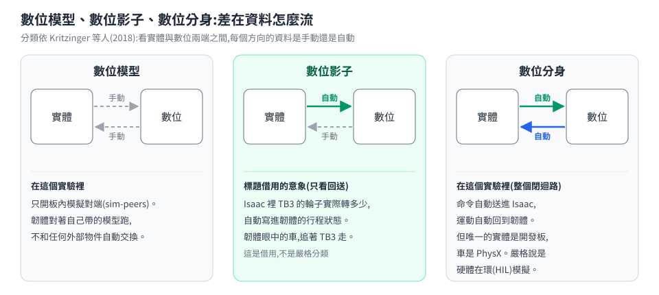
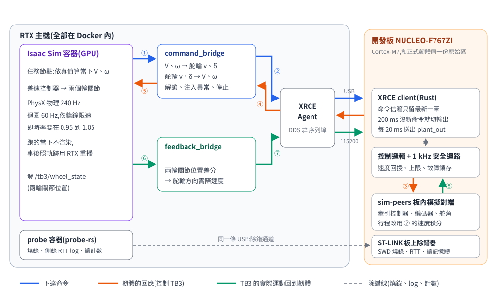
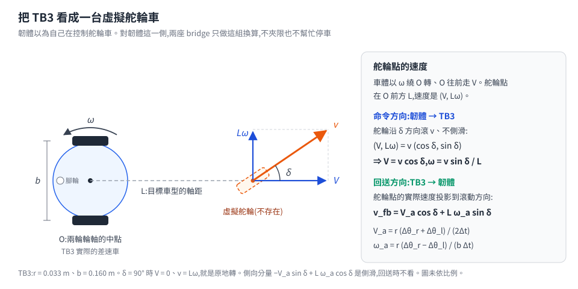
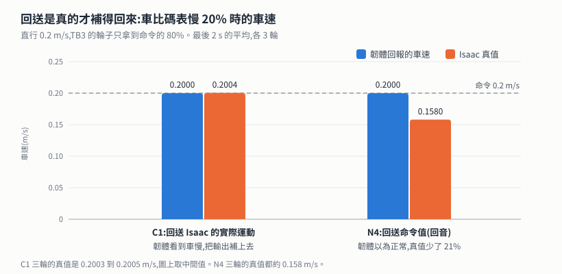

# 數位影子:讓開發板上的韌體開 Isaac Sim 裡的 TurtleBot3

一塊 STM32 開發板跑著正式的 Rust 韌體,透過 ROS 2 指揮模擬器裡的一台 TurtleBot3 Burger(以下稱 TB3,一台差速兩輪小車),在 Isaac Sim 的空地上繞 1 m 正方形三圈。韌體的輸出決定 TB3 怎麼動,TB3 的輪子實際轉了多少再回到韌體,韌體看到的車速與里程都來自 Isaac 的物理。這篇從「為什麼要這樣接」講起,接著推導兩邊的換算公式,說明誰負責安全,再一步步說明怎麼在一台 RTX 主機上把開發板、Isaac Sim、bridge 與控制串起來,最後是驗證方法與量到的數字。

> 來源:作者 2026 年 11 月的私人實驗紀錄(實驗計畫、逐輪收據、Isaac 執行器與 bridge 原始碼)。原始 repo 不公開,這裡只寫機制與量測結果,車型、廠商與通訊協定的實際數值都改成通稱。
> 延伸閱讀:[主板模擬:Renode](../10-core/20-firmware/board-simulation-renode.md)、[上下位機通訊](../10-core/20-firmware/host-mcu-protocol.md)、[底層控制](../10-core/20-firmware/low-level-control.md)、[運動學與座標轉換](../10-core/30-navigation/kinematics-and-coordinate-transforms.md)、[ROS 2 與 DDS](../40-fleet/ros2-dds-intro.md)、[Isaac Sim / Isaac Lab](isaac-sim-isaac-lab-amr.md)、[Sim-to-real](sim-to-real.md)。

---

## 1. 要解決的問題:韌體需要一台會「頂嘴」的車

韌體的工作是把上位命令變成馬達輸出,出錯時把車停下來。要驗證它,得有一台會回應的車。手上有四種選擇:

| 做法 | 能證明什麼 | 證明不了什麼 |
|---|---|---|
| 上實車 | 全部都是真的 | 貴、危險、難注入故障,也沒有位姿真值可以對照 |
| 主機上編譯或 Renode 模擬 | 邏輯、周邊行為,可重現 | MCU 的實際中斷與時序要上真板才算數 |
| 真板 + 板內模型 | 真的 MCU、真的中斷、真的接收路徑 | 模型參數是韌體作者自己給的,模型裡沒有的損失與打滑就永遠不會出現 |
| 真板 + 外部物理模擬 | 回授來自韌體以外、照物理走的東西 | 實體馬達、電氣與實車動態 |

第三列的盲點是關鍵。韌體帶著一個自己寫的車體模型,等於自問自答:模型說車速是多少,韌體就看到多少。要讓韌體被「頂嘴」,回授必須來自它控制不了的地方。這篇的做法就是第四列:韌體照舊跑在真板上,車換成 Isaac Sim 裡的 TB3,由 PhysX 物理引擎決定輪子實際轉多少。

選 TB3 有個實際的理由:它在 Isaac 裡已經有量過的基準。沒有韌體、直接下命令時,三圈回原點差 4.1 mm。接上韌體之後出問題,比較容易分辨是韌體還是車。

## 2. 數位模型、數位影子、數位分身

<p align="center"></p>

這三個詞常被混用。Kritzinger 等人在 2018 年的回顧論文用一個簡單的標準區分:看實體與數位兩端之間,每個方向的資料是手動還是自動。

- **數位模型(Digital Model)**:兩個方向都手動。模型和實體之間沒有自動交換。
- **數位影子(Digital Shadow)**:實體的狀態自動流進數位端,數位端要影響實體還是得靠人。
- **數位分身(Digital Twin)**:兩個方向都自動。

套到這個實驗:

- 只開板內模型時,韌體對著自己的模型跑,外面沒有物理對端,屬於數位模型。
- 單看回送方向,TB3 的輪子實際轉多少,自動寫進韌體內的行程狀態。韌體眼中的那台車,就是 Isaac 裡 TB3 的影子。這篇標題的「數位影子」指的是這一條。
- 整個閉迴路的命令與回送都是自動的,資料流已經到分身的等級。但「實體」那一端仍是 PhysX,這個實驗沒有實車,結果不能直接推論到實車。

## 3. 系統全貌

<p align="center"></p>

先認識圖上的角色:

| 角色 | 在哪 | 做什麼 |
|---|---|---|
| 任務節點 | Isaac 行程內 | 每 1/60 s 依 TB3 的真值位姿算出「現在」該走多快、轉多快 |
| `command_bridge` | 主機容器 | 任務的 (V, ω) 換成舵輪命令送給韌體;韌體模型輸出的舵輪速度換回 (V, ω) 給 TB3;也負責啟動 Agent、解鎖與注入異常 |
| `feedback_bridge` | 主機容器 | TB3 兩輪的關節位置換算成「虛擬舵輪」的實際速度,送回韌體 |
| XRCE Agent | 和 `command_bridge` 同一個容器 | XRCE(DDS for eXtremely Resource Constrained Environments)讓記憶體很小的 MCU 也能用序列埠加入 ROS 2。主機上的 Agent 把 DDS 資料轉成序列框,韌體裡的 XRCE client 負責另一端 |
| 韌體 | 開發板 | 正式的控制邏輯與 1 kHz 安全迴路,另外編入板內模擬對端 |
| 板內模擬對端(sim-peers) | 韌體內,建置時明確選用 | 扮演牽引馬達控制器、編碼器與舵角。韌體送出的 CAN 幀與 DAC 輸出經硬體回送(loopback)交給它,它的回覆也經回送進韌體,所以韌體走的是正式的接收中斷 |
| probe 容器 | 主機容器 | 用 probe-rs 經板上的 ST-LINK 燒錄、側錄 log、收尾讀計數 |

每個元件只懂自己這一層。任務節點不知道有韌體,韌體不知道 TB3 的輪距,所有換算都在兩座 bridge 裡。

下表依圖上的編號走一圈。筆數取自三圈的第 1 輪。

| 編號 | 從哪到哪 | 送的東西 | 頻率 | 第 1 輪的筆數 |
|---|---|---|---|---|
| ① | 任務節點 → `command_bridge` | 當下要的 V、ω | 60 Hz | 收到 10638 |
| ② | `command_bridge` → Agent → 序列埠 → 韌體 | 舵輪速度 v、舵角 δ、序號 | 20 Hz | 送 4098,韌體收到 4079 |
| ③ | 韌體 → 板內模擬對端 | 牽引命令(CAN)、舵角 DAC | 50 Hz | 10599 幀,DAC 寫入 21724 次、失敗 0 |
| ④ | 板內模擬對端 → 韌體 → Agent → `command_bridge`(`plant_out`) | 模型算出的舵輪速度與舵角 | 50 Hz | 送 10349,收到 10241 |
| ⑤ | `command_bridge` → Isaac | 換算後的 V、ω | 50 Hz | 送 10241 |
| ⑥ | Isaac → `feedback_bridge` | 兩輪關節位置,帶模擬時間 | 60 Hz | 收到 10638 |
| ⑦ | `feedback_bridge` → Agent → 韌體(`plant_in`) | 虛擬舵輪方向的實際速度 | 50 Hz | 送 8864,韌體收到 8864 |
| ⑧ | 板內模擬對端 → 韌體 | 編碼器讀值,經 CAN 回送 | 200 Hz | 請求 42400,回覆 42399 |

TB3 收到的速度就是 ④ 的模型輸出換算來的,④ 與 ⑤ 的筆數因此相同。② 少掉的 19 筆,絕大多數是 XRCE 連線還沒建好時送出的。

筆數相符只代表有送到。內容也要核對:模擬對端的輸出換算成車體速度後,和 TB3 的真值比,線速度相關係數 0.9999、均方根誤差 1.9 mm/s。原地轉的真值約是命令的 0.92 倍;不接韌體、直接下命令時也是這個比例,所以差距出在 TB3 輪子與地面在 Isaac 裡的接觸模型,與韌體無關。

## 4. 換算:把差速車偽裝成舵輪車

韌體是為一台舵輪車寫的:前方一個可轉向的驅動輪,後方兩個固定輪。TB3 是差速車,沒有舵輪。要讓韌體以為自己在開舵輪車,兩座 bridge 得在兩種運動描述之間換算。

<p align="center"></p>

### 4.1 從舵輪點的速度推出來

把 TB3 的兩輪輪軸中點 O 當成舵輪車的後軸中點,在它前方 L 的地方想像一個舵輪。L 用韌體設定的目標車型軸距,讓韌體的速度上限照原本的車型生效。

車體以 ω 繞 O 轉、O 往前走 V。剛體上任一點的速度等於 O 的速度加上旋轉造成的速度,舵輪點在 O 前方 L,所以它的速度是 (V, Lω):往前 V,往左 Lω。

**命令方向(韌體 → TB3)。** 韌體的模型說舵輪沿 δ 方向滾 v。輪子不側滑,表示舵輪點的速度整個落在滾動方向上:

```text
(V, Lω) = v (cos δ, sin δ)
⇒ V = v cos δ
   ω = v sin δ / L
```

δ = 0 時 ω = 0,直走。δ = 90° 時 V = 0、v = Lω,車在原地轉。

**回送方向(TB3 → 韌體)。** TB3 實際的 V_a、ω_a 不一定剛好符合「不側滑」。韌體的編碼器量的是舵輪沿滾動方向轉了多少,所以把舵輪點的實際速度投影到滾動方向:

```text
v_fb = V_a cos δ + L ω_a sin δ
```

垂直滾動方向的分量是側滑,真實的編碼器量不到,這裡也丟掉。沒有任何損失時,把命令方向的式子代進去,v_fb 剛好等於 v。

上位任務送來的是 (V, ω),`command_bridge` 要先反算成舵輪命令:δ = atan2(Lω, V)、v = √(V² + L²ω²)。倒車時舵輪不翻 180°,改成輪速取負號。

### 4.2 TB3 的實際速度從哪來

`feedback_bridge` 用兩輪**關節位置的差分**算 V_a、ω_a,不用 PhysX 給的關節速度讀值。真車的編碼器量的是位置,這樣比較接近真車的資訊來源。

```text
V_a = r (Δθ_r + Δθ_l) / (2Δt)
ω_a = r (Δθ_r − Δθ_l) / (b Δt)
```

TB3 的輪半徑 r = 0.033 m、輪距 b = 0.160 m,執行時由 USD 模型的包圍盒讀回核對。實作有兩個細節:

- 轉動關節的位置在 (−π, π] 之間繞回,差分前要先把差值折回這個範圍,否則每轉一圈會跳一次 2π。
- Isaac 每 1/60 s 發一筆關節位置,回送是 50 Hz。每次回送要把這段時間內的所有差分累加起來求平均,只取最後一步會漏掉中間的運動。

### 4.3 bridge 不幫忙

兩座 bridge 只做換算,不夾限、不逾時,也不幫忙停車。速度上限、命令逾時與故障停車都要由韌體自己證明。bridge 多做一點保護,就分不清車停下來是誰的功勞。

## 5. 控制:安全由韌體負責

### 5.1 命令一筆一筆送

韌體從頭到尾只知道「此刻」的命令,下一段路長什麼樣它不知道。所以只要命令停止進來,車自然會停。

- 任務節點以 60 Hz 計算此刻的 (V, ω)。
- `command_bridge` 以 20 Hz 拿手上最新的 (V, ω),換成一筆舵輪命令送出。
- Agent 只負責轉手,沒有任何緩衝。
- 韌體用一個只放得下一筆的命令信箱,新的來就蓋掉舊的。信箱裡的命令放了 200 ms 還沒被更新,韌體就切掉輸出。
- 想馬上停,上位直接送停止命令,省掉那 200 ms。

<p align="center"></p>

信箱只留一筆的理由:佇列裡排著的舊命令,在命令流中斷後還會繼續把車往前推。只留最新一筆,停止的條件就只剩「有沒有新命令」。

車以 0.2 m/s 直走時,逐一製造下列狀況。每種跑 3 輪,表中是 3 輪的最小到最大,時間從狀況發生起算:

| 狀況 | 多久察覺 | 多久回報已停 | 多走的距離 |
|---|---|---|---|
| 上位送停止命令 | 0.03 到 0.06 s | 0.88 到 0.90 s | 5.4 到 5.5 cm |
| 命令流中斷 | 0.21 到 0.30 s | 1.10 到 1.14 s | 9.2 到 9.9 cm |
| 牽引控制器回報錯誤 | 0.23 到 0.30 s | 1.10 到 1.17 s | 10.0 到 11.2 cm |
| DAC 寫入失敗 | 0.20 到 0.25 s | 1.10 s | 9.1 到 9.6 cm |
| 編碼器沒有回應 | 0.23 到 0.25 s | 刻意不停車,退回前饋 | 車速維持 0.20 m/s |

停止命令的設計:韌體依來源分別記住停止要求,任一來源要求就切輸出。解除只解除該來源,全部解除後車照斜坡恢復,不必重新解鎖。DAC 寫入失敗連續 200 ms 會鎖存故障,要重開機或明確清除才能再走。

### 5.2 回授讓韌體修正

把 TB3 的輪速打 8 折,模擬「車比碼表慢」。韌體從回送看到車速偏低,把輸出補上去。3 輪最後 2 s 的真值車速落在 0.2003 與 0.2005 m/s 之間。這是閉迴路的主要證據,第 7 節用負對照證明補償確實來自 Isaac 的物理。

### 5.3 回送斷掉時

回送超過 200 ms 沒更新,韌體退回板內模型的積分,並累計一個過期計數。選擇退回內部模型有它的理由:Agent 中斷時韌體會停車,這時若沿用最後一筆回送速度,編碼器會一直跑,重新連線與解鎖都沒辦法驗。

退回本身是靜默的,判讀器因此要求解鎖後過期計數不能增加。韌體偷偷改用自己的模型時,結果會被判 FAIL。

## 6. 在 RTX 主機上組起來

### 6.1 硬體

| 項目 | 這個實驗用的 | 說明 |
|---|---|---|
| 主機 | 28 核、61 GiB 記憶體、RTX 2000 Ada 16 GB | 和別人共用,實驗最多佔 14 核 |
| 開發板 | NUCLEO-F767ZI(Cortex-M7) | 和正式韌體同一份原始碼,建置時多開開發板與模擬的選項。正式板是另一顆 Cortex-M4 |
| 線材 | 一條 USB | 板上的 ST-LINK 同時提供除錯通道與虛擬序列埠 |

開發板和主機之間只有一條 USB,上面跑兩條通道:

- **SWD(Serial Wire Debug)**:ARM 的兩線除錯介面。用來燒錄、重置,也能在 CPU 執行中直接讀記憶體。收尾讀韌體計數靠它。
- **RTT(Real-Time Transfer)**:韌體把 log 寫進記憶體裡的環形緩衝,除錯器經 SWD 讀走,不佔序列埠。
- **虛擬序列埠(VCP)**:ST-LINK 把板上的 UART 轉成主機上的 `/dev/ttyACM*`。XRCE 走這條,115200 bps。

板上沒有實體的 CAN 收發器、DAC 晶片與馬達:

- CAN 控制器設成 silent loopback,幀經過真的 CAN 周邊,但不上線。
- DAC 的 SPI 照常送出,板上沒接晶片。SPI 主端不需要接收端也送得完,所以「寫入失敗」要靠異常注入才走得到。
- 馬達控制器、編碼器與舵角都在板內模擬對端裡。

### 6.2 容器配置

每個元件各自一個 Docker 容器,用完即刪(`--rm`),並限制記憶體、CPU、行程數與 log 大小。

| 容器 | 映像 | CPU | 記憶體 | 裝置 |
|---|---|---|---|---|
| Isaac Sim | `nvcr.io/nvidia/isaac-sim:6.0.1` | 綁 0 到 11 號核 | 16 GiB | `--gpus all` |
| `command_bridge` + Agent | 自建的 ROS 2 Jazzy + Rust 映像 | 綁 12、13 號核 | 3 GiB | 序列埠 |
| `feedback_bridge` | 同上 | 共用 12、13 | 1 GiB | 無 |
| probe | 自建,內含 probe-rs | 共用 12、13 | 512 MiB | USB 除錯器 |

網路的做法:

- `command_bridge` 的容器用 `--network none --ipc shareable` 起來,持有網路與共享記憶體的命名空間。
- 其他容器用 `--network container:<command_bridge> --ipc container:<command_bridge>` 加入同一組命名空間。
- 全部設 `ROS_LOCALHOST_ONLY=1`、同一個 `ROS_DOMAIN_ID`、同一個 RMW 實作(Fast DDS)。

DDS 靠 loopback 與共享記憶體找到彼此。放進同一組命名空間,容器之間就能互相發現;`--network none` 讓它們和共用主機上其他人的 DDS 完全隔開。

CPU 用 `--cpuset-cpus` 指定固定的核心,不用 `--cpus` 的時間配額。Isaac 依看得到的核數開 worker 執行緒,28 個 worker 搶 6 核的配額時,240 Hz 不限速的即時率只有 0.64 到 0.87,而且每輪差很多;綁 12 核之後是 4.17,兩輪一致。

### 6.3 一輪的順序

<p align="center"></p>

容器之間用收據目錄裡的旗標檔排順序。幾個順序有它的理由:

- **`feedback_bridge` 要在 Agent 啟動前就緒。** Agent 已經在收發資料時它才加入,DDS 的探索過程會讓模型輸出中斷約 360 ms,這在大約半數的輪次發生,時間點在解鎖前。先讓它建好訂閱再啟動 Agent,空檔就落在資料開始流之前。
- **有狀態、有回送才解鎖。** 解鎖前車不動,回送的空檔不影響里程;解鎖時回送已經在流,韌體從第一步就用 Isaac 的物理。
- **Isaac 看到 armed 檔才開始任務。** 之前它照常步進、發關節位置,讓回送先流起來。
- **收尾經 SWD 讀計數。** 序列埠溢位、送出等待、DAC 寫入次數、回送收到數與過期次數都在韌體的記憶體裡,用 SWD 讀出來,不靠韌體自己回報。

### 6.4 Isaac 端:RTX 要注意的事

Isaac 執行器是一支 Python 腳本,用 `SimulationApp({"headless": True})` 無畫面啟動,透過 rclpy 收發 ROS 2,不經 OmniGraph。

**物理與迴圈。** `World` 設 `physics_dt = 1/240`、`rendering_dt = 1/60`,控制迴圈 60 Hz,每圈走 4 個物理子步。輪子用速度驅動(執行器預設 stiffness 0、damping 1000、最大力矩 5 N·m),由 Isaac 的 `DifferentialController` 把 (V, ω) 換成兩輪角速度。物理 60 Hz 時原地轉的實際速度只有命令的 0.23 倍,240 Hz 是 0.92 倍,所以接韌體的輪次都用 240 Hz。

**一個不會報錯的坑。** 呼叫 `world.step(render=False)` 時,物理只前進一個 `physics_dt`(1/240 s)。每圈若只呼叫一次,物理時間只有迴圈時間的 1/4,即時率與回原點照樣好看。這個 bug 是在輪速與實際車速對不上時抓到的。修法是每圈呼叫 4 次,並在結束時核對「迴圈累計的時間」等於「PhysX 讀回的物理時間」。

**兩邊的時鐘要一致。** 韌體用 MCU 的毫秒計時器積分里程,Isaac 的時間則由模擬步數決定。模擬跑得比真實快或慢,同一段運動在兩邊就換算出不同的車速,而且沒有任何一層會報錯。處理方式:

- 執行器依牆鐘限速,每步算完就睡到該到的時間。
- 每 10 s 記一次即時率。只要有一段落在 0.95 到 1.05 之外,那一輪就算環境失敗,數字不拿來評估韌體。

**渲染與錄影。** 在 RTX 2000 上一邊模擬一邊出畫面,算圖拖慢了模擬,韌體里程與 Isaac 行程的比值變成 1.84,那一輪只能作廢。所以跑的當下不渲染,只把每一步的 PhysX 真值位姿寫進 `trajectory.csv`。事後另起一個 Isaac,照軌跡把 TB3 擺回當時的位姿,用 RTX 相機出影格,再和韌體的 RTT log 依時間並排合成影片,畫面上標明是軌跡重播。物理與渲染分開跑,渲染多慢都不影響實驗。

**理想化項。** 輪子的碰撞體換成同半徑的球,腳輪摩擦設 0。這兩項讓基準乾淨,但也是和真車的差異,報告裡要列出來。

**生效要自己證明。** 幾個回傳值不可信的地方:

- 啟用 ROS 2 bridge 擴充時,`enable_extension` 回傳成功不代表真的載入。要在已註冊的節點型別裡找得到 bridge 的節點,才算它活著。
- 腳本裡拋出的 Python 例外,不會讓 Isaac 行程以非零結束碼退出。執行器另外把成敗寫進 `env.json` 的 `ok` 欄位,外層依這個欄位判斷。
- `app.close()` 偶爾會卡住。結果寫完後直接 `os._exit`,不讓它拖住外層的逾時。
- 輪子的半徑與輪距執行時從模型讀回,和常數比對,寫進收據。

### 6.5 指令骨架

下面是依上述配置整理的骨架,名稱與路徑都是示意,實際參數依自己的映像調整。

```bash
# 1. 燒錄、重置、側錄 RTT(probe 容器,只掛 USB 除錯器)
docker run --rm --network none --memory 512m --pids-limit 64 \
  --device /dev/bus/usb/<bus>/<dev> -v "$PWD/fw:/fw:ro" <probe-image> \
  probe-rs download --chip STM32F767ZITx --connect-under-reset --verify /fw/firmware.elf
docker run --rm --network none --device /dev/bus/usb/<bus>/<dev> -v "$PWD/fw:/fw:ro" <probe-image> \
  probe-rs attach --chip STM32F767ZITx /fw/firmware.elf > run/rtt.log &

# 2. command_bridge + Agent:持有網路與 IPC,掛序列埠
docker run --rm --name exp-cmd --network none --ipc shareable --shm-size 1g \
  --cpuset-cpus 12-13 --memory 3g --pids-limit 512 \
  --device /dev/ttyACM0:/dev/ttyFW0 --group-add <tty-gid> \
  -e ROS_DOMAIN_ID=0 -e ROS_LOCALHOST_ONLY=1 -e RMW_IMPLEMENTATION=rmw_fastrtps_cpp \
  -v "$PWD/run:/w/run" <ros2-rust-image> command_bridge --agent-after /w/run/feedback_ready ...

# 3. feedback_bridge:加入同一組命名空間
docker run --rm --name exp-fb --network container:exp-cmd --ipc container:exp-cmd \
  --cpuset-cpus 12-13 --memory 1g -e ROS_DOMAIN_ID=0 -e ROS_LOCALHOST_ONLY=1 \
  -e RMW_IMPLEMENTATION=rmw_fastrtps_cpp -v "$PWD/run:/w/run" <ros2-rust-image> \
  feedback_bridge --ready-file /w/run/feedback_ready ...

# 4. Isaac Sim:GPU、綁 12 核、無畫面
docker run --rm --name exp-isaac --gpus all --network container:exp-cmd --ipc container:exp-cmd \
  --cpuset-cpus 0-11 --memory 16g -e ACCEPT_EULA=Y -e PRIVACY_CONSENT=Y \
  -e ROS_DOMAIN_ID=0 -e ROS_LOCALHOST_ONLY=1 -e ROS_DISTRO=jazzy \
  -e RMW_IMPLEMENTATION=rmw_fastrtps_cpp \
  -e LD_LIBRARY_PATH=/isaac-sim/exts/isaacsim.ros2.core/jazzy/lib \
  -v "$PWD/isaac:/w/isaac:ro" -v "$PWD/assets:/w/assets:ro" -v "$PWD/run:/w/run" \
  --entrypoint /isaac-sim/python.sh nvcr.io/nvidia/isaac-sim:6.0.1 \
  /w/isaac/tb3_run.py --hz 240 --sample-hz 60 --start-file /w/run/armed ...
```

Isaac 映像裡內建 ROS 2 Jazzy 的函式庫,用 `LD_LIBRARY_PATH` 指過去,容器裡不必另裝 ROS 2。TB3 的 USD 模型事先在有網路的機器上抓好,唯讀掛進去,所以 Isaac 容器可以 `--network none`。

## 7. 怎麼證明它真的閉環

「車走完了」不足以證明任何事。車可能根本沒經過韌體,韌體可能偷偷用自己的模型,停車可能是注入本身造成的。這個實驗用三個手段把這些可能逐一排除。

**判準先寫死。** 每個階段開跑前,先把通過條件寫成文件提交到版控,看到結果後不再調鬆。每個案例跑 3 輪,3 輪同向才算數。

**鏈路對帳。** 相鄰兩段的筆數要對得上(第 3 節的表)。韌體只開機一次、故障位元為 0、序列埠沒有溢位、DAC 寫入失敗為 0,這些都寫進每輪的收據,連同韌體與映像的雜湊。

**負對照。** 每一個「靠韌體才通過」的說法,都配一個拿掉那個機制的版本,結果必須 FAIL,而且判讀器給的原因要和預期一字不差。

| 負對照 | 拿掉或改掉什麼 | 結果 | 證明什麼 |
|---|---|---|---|
| N1 | 讓板內模型的牽引卡死 | TB3 完全沒動 | TB3 的動作來自模型輸出 |
| N2 | 不經韌體,任務的命令直送 TB3 | 車照樣走完,但筆數對帳不過 | 判讀器看得出命令有沒有經過韌體 |
| N3 | 送出超過行走上限的命令 | 韌體拒收,車不動 | 上限確實生效 |
| N4 | 輪速打 8 折,回送卻填命令值 | 真值只剩 0.158 m/s | 第 5.2 節的補償要靠真的回送 |
| N5 | 一筆回送都不發 | 「回送有在用」這一項不過 | 韌體改用自己的模型時會被發現 |
| N6 | 解鎖後暫停回送 1 s | 「回送沒有過期」這一項不過 | 跑到一半的回送中斷也會被發現 |
| N7 | 另建一顆拿掉 DAC 故障機制的韌體 | 車繼續走 | DAC 故障停車靠的是韌體 |
| N8 | 另建一顆拿掉停止命令的韌體 | 4 s 內車多走 0.80 m | 停止命令靠的是韌體 |

<p align="center"></p>

C1 和 N4 的韌體都回報 0.2000 m/s,差別只在回送的是什麼。只看韌體的回報分不出兩者,要看 Isaac 的真值才分得出來。

一個踩過的坑:板內異常存在跨重置保留的記憶體區,重燒與重置都不會清。試跑時注入的「牽引卡住」沒被清掉,之後幾個負對照的 FAIL 其實是車被卡住造成的,只是剛好符合預期。所以判讀器除了 FAIL,還要核對原因與車有沒有動;bridge 解鎖前清掉全部異常,判讀器要求開機時的異常遮罩為 0。

## 8. 結果

正式批次 42 輪,加上 N7、N8 各 3 輪,結果與原因都和開跑前寫下的預期一致。沒有任何一輪因即時率偏離而作廢。

| 項目(正方形三圈) | 第 1 輪 | 第 2 輪 | 第 3 輪 | 通過條件 |
|---|---|---|---|---|
| 回原點差 | 10.7 mm | 11.9 mm | 10.6 mm | ≤ 5 cm |
| 偏航差 | 0.535° | 0.607° | 0.617° | ≤ 1° |
| 韌體里程 ÷ Isaac 行程 | 0.9920 | 0.9939 | 0.9914 | 1 ± 2% |
| 往返延遲 p99 | 48.5 ms | 44.8 ms | 48.6 ms | 只記錄 |

韌體自己累積的里程與 Isaac 裡 TB3 實際走的距離相差不到 0.9%。如果韌體偷用自己的模型,這兩個數不會貼得這麼近。

歷次 24 輪的回原點差最小 2.1 mm、最大 29.8 mm。散布來自 `command_bridge` 每 50 ms 才送一次命令。直線段的長度固定,走完它的時間也固定,於是「該停了」那一刻容易落在兩次送命令的交界:趕上這一拍,停車滑行一種長度;晚一個物理步(1/60 s)沒趕上,停止命令要等下一拍,晚約 33 ms,滑行多約 8 mm。一輪裡四個角落都落在同一種時,誤差互相抵消;混了兩種就抵消不掉。命令頻率提高到 50 Hz 的探索輪裡,只剩一種滑行長度。這個量化大約是「車速 × 取樣週期」,車越快越明顯。

## 9. 限制

- 沒有實車,也沒有實體馬達、DAC 晶片與 CAN 收發器。板內模型的參數都是估值,TB3 的結果不能推論到目標車型的動態。
- 開發板是 Cortex-M7,正式板是 Cortex-M4,執行週期數不能直接搬過去。
- 回送比實車多繞一大圈:先等 Isaac 算完一步,再經 ROS 2、Agent,最後擠過 115200 bps 的序列埠。往返 p99 約 45 到 49 ms,實車的編碼器沒有這段延遲。上板前在主機的原生測試量過,速度迴路在 200 ms 以內的延遲都穩定。
- DAC 故障只看得到 SPI 傳輸有沒有完成。DAC 晶片本身壞掉或接線斷了,SPI 依舊能送完,韌體察覺不到。
- TB3 沒有轉向關節,舵角沒有物理量可以回送,仍由板內模型提供。
- 解鎖前偶爾有約 350 ms 的狀態空檔。Agent 開到最細的 log 顯示序列埠接收照常,寫進 DDS 停了約 338 ms,可以排除韌體與序列埠;卡在 Fast DDS 的哪個環節還沒查。這個空檔只出現在解鎖前。
- 影片是事後的軌跡重播,車的位置與韌體 log 都是當輪紀錄,但畫面不是即時渲染。

## 10. 名詞

| 詞 | 一句話 |
|---|---|
| 數位影子(Digital Shadow) | 實體狀態自動流進數位端,反向仍靠人工 |
| 板內模擬對端(sim-peers) | 編進韌體、扮演馬達控制器與感測器的模型,經硬體回送接上韌體的正式接收路徑 |
| 虛擬舵輪 | TB3 沒有的舵輪。韌體眼中的 (v, δ) 經換算對應到 TB3 的 (V, ω) |
| XRCE | 小型 MCU 用序列埠加入 ROS 2 的協定;MCU 上跑 client,主機上的 Agent 轉進 DDS |
| SWD / RTT | ARM 的兩線除錯介面 / 經除錯器讀走記憶體裡 log 的機制 |
| 即時率(real-time factor) | 模擬時間 ÷ 牆鐘時間,1 表示和真實時間一樣快 |
| 負對照 | 刻意拿掉某個機制,結果必須 FAIL,用來證明通過是靠那個機制 |
| 軌跡重播 | 跑完後照紀錄把車擺回當時的位姿,再渲染成影格 |

## 來源

- W. Kritzinger, M. Karner, G. Traar, J. Henjes, W. Sihn, "Digital Twin in manufacturing: A categorical literature review and classification," *IFAC-PapersOnLine* 51(11), 2018, pp. 1016–1022. DOI [10.1016/j.ifacol.2018.08.474](https://doi.org/10.1016/j.ifacol.2018.08.474)。
- NVIDIA Isaac Sim 容器映像 `nvcr.io/nvidia/isaac-sim:6.0.1`。
- 實驗計畫、逐輪結果、Isaac 執行器與 bridge 原始碼:作者的私人 repo(2026-11),不公開。
